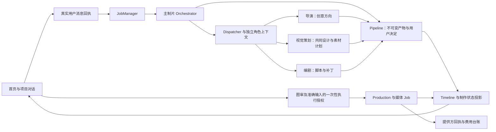

# Agent 架构与交互整体审计 · 2026-10-04

记录包含初次审计和用户随后要求的修复。以下原审计结论保留用于追溯；最新状态见末尾「修复与再次复核」。

截图、反例和日志为当时本机临时证据，未随 Git 提交；下文文件名相对本机临时目录，仅用于追溯。跨电脑复核使用仓库正式回归；当前能力、服务加载及后续验收状态统一见[实现与验收状态](product-improvements.md)。

初次审计对象：`apps/us-video-studio` 当前工作树（HEAD `6d8287c`，包含上一轮参考视频修复的未提交改动）。初次审计没有修改实现、迁移真实数据、重启现用服务或调用真实模型/媒体提供方。

结论：四角色结构、统一业务状态和用户授权边界可以保留；目前发现 7 个已复现缺口，2 个 P1、5 个 P2。主要问题是本轮交付归属、角色收尾与新消息之间的竞争，以及前端下一动作没有完整遵循任务形式。需要修复这些接缝，无需为了修复另建 Agent、状态库或调度系统。

## 当前结构及已成立的边界

- 主制片管理需求、参考、任务范围及派工；专业角色只能提交自己负责的阶段或已绑定范围的补丁。角色会话保存历史和收件箱，具体 attempt 保存本次执行身份；它们不是两套业务批准状态。
- 父任务等待子角色真实结束；产物以准确版本、字节指纹和上游来源绑定。停止保留已保存内容，重启记录中断，不自动重放。
- 新任务不调用独立 reviewer：审核工具及新的审核 HTTP 入口已停用，历史审核不再阻挡用户采用。历史记录本身无需删除，但连接冻结仍有 A7 的残留依赖。
- 按钮与自然语言创作决定共用可信服务和 `Pipeline.record_approval`。自然语言不能直接提交生成。图审只覆盖实际确认的图片字节，生成另核对输入、范围、参数和费用。
- 制作端以同一份 `target_shots / coverage` 投影逐镜状态；一张图片或一个输入不算整套完成。旧结果、未知提交和当前结果有不同状态；未知任务不能以新版输入掩盖并再次提交。

以上是代码、离线边界与当前渲染的证据，不是实际模型创作质量或真实提供方可用性的验收。

## 已确认问题

### A1 · P1 · 旧稿被计为本轮重新交付完成

入口：[task_contract.py:108](../studio/task_contract.py#L108)。`intake/direction/writing` 只核对项目当前有效产物，没有核对本轮新交付归属。

真实 HTTP 输入“请重新做一套完整视频方案，旧稿仅供对照，本轮重新交付。”，严格离线模型仅解释为 `intent=new / deliverable=writing` 并最终声称完成。没有派工或保存新版本，Job 仍是 `succeeded`，交付是 `complete`，四阶段都保持 v1。

影响：用户要求重做，但页面可能把旧方案作为已完成成果；模型的错误总结没有被程序挡住。应冻结本轮基线，区分新交付与明确复用。方向、需求和完整脚本均应按任务契约核对；不能强制所有讨论都新建版本。

### A2 · P1 · 角色保存作品后收到的补充永久滞留

入口：[dispatch.py:555](../studio/tools/dispatch.py#L555)、[dispatch.py:297](../studio/tools/dispatch.py#L297)、[jobs.py:32](../studio/jobs.py#L32)、[dispatch.py:330](../studio/tools/dispatch.py#L330)。

完整生产入口复现：`/jobs → Orchestrator → plan_revision → writer.submit_patch`。在保存已完成、会话尚未结束的窗口，定向 `/steer` 接受补充并返回 `delivered`。随后父 Job 和角色都完成，收件箱 `pending_count=1`，补充原话没有进入任何模型请求。父任务接续排除定向消息，完成会话的恢复又返回已有产物，补充没有可用的消费路径。

影响：界面表示要求已经投递，实际没有执行，而且任务显示成功。应把提交收尾和收件箱结算统一处理；收到但未执行的消息必须有明确状态和安全接续，不能冒充“已处理”。补充若要求新改稿，应绑定新基线，不能直接重放已完成的旧 attempt。

### A3 · P2 · 角色恢复把停止、进度查询及讨论当成重新开工

入口：[http_execution.py:283](../studio/http_execution.py#L283)、[server.py:122](../studio/server.py#L122)。

对未完成角色的显式恢复接口分别输入“停止”“现在进度怎么样？”“只讨论为什么失败，不要改稿”，都开启新角色轮次并调用一次离线模型，最后成为失败任务。入口核对旧角色状态后直接恢复，没有在调用前核对这条新真实消息的执行范围。

影响：该恢复通道违反只读/停止语义，可能产生不必要的文字调用。应先解析控制意图和范围，再决定查询、停止、讨论或继续原任务。此反例只证明角色恢复接口，不能据此声称普通聊天的进度查询也会误开工。

### A4 · P2 · 视频改成图文后，常规刷新继续沿用旧类型

入口：[app.js:328](../studio/web/app.js#L328)、[timeline.py:95](../studio/timeline.py#L95)、[http_runs.py:48](../studio/http_runs.py#L48)。

真实 HTTP 投影的明确形式从 `video` 改为 `photo` 后，项目列表返回 `photo`；timeline 的 run 没有当前形式。真实前端 `selectRun / refreshTimeline` 优先采用旧项目列表缓存，结果仍是 `creatorView.format=video`，视频入口仍显示。

影响：Agent 已按图文推进，用户仍看到视频画布和入口。应让 timeline 提供同源的当前形式并在刷新时更新当前项目，不能依赖用户回首页或刷新整页才纠正。

### A5 · P2 · 正确识别为图文后，图片确认仍引向视频且按钮无效

入口：[creator-view.js:112](../studio/web/creator-view.js#L112)、[journey.js:168](../studio/web/journey.js#L168)、[journey.js:599](../studio/web/journey.js#L599)。

全新图文项目，准确脚本已采用，一张现有图片已通过本地审核。后端没有视频接续、`video_sequence=[]`，没有模型或媒体调用；前端却显示“参考图已确认，下一步准备视频”及“准备这张图的视频输入”。图文的视频入口被隐藏，点击下一动作仍停留在原画布。

真实浏览器再次复现：首页项目卡、项目顶栏和对话制作卡都有错误视频指引。图文方案与图片结果画布本身按图文显示，说明这不是 A4 的缓存问题；修复类型刷新仍不足以解决本项。

影响：图片确认后主流程走入死路。下一工作和主动作须按项目形式筛选，图文继续指向图片制作、结果核对或发布文案。

当前代码的隔离图文项目：目标为图片与文案，仍提示准备视频：`studio-architecture-audit-20261004-39857dba/17-photo-wrong-action.jpg`

### A6 · P2 · 未回答问题，进度查询也会将其标记为已答

入口：[orchestrator.py:199](../studio/agents/orchestrator.py#L199)、[interactions.py:52](../studio/interactions.py#L52)。

真实 HTTP 第一轮询问“你希望更偏哪种表达？”。用户下一条输入“先不要选，我只是问目前做到哪一步了？”，没有绑定问题选择。主制片在解释新任务前无条件调用 `answer`，把这条进度查询记为该问题的答案，`pending_question` 变为 null；最终回复仍表示正在等用户选择。

影响：待答卡消失，实际必要决定尚未形成。应按准确问题绑定或可信解释核对答复关系；无关消息、进度查询和暂停不能默认消费问题。既要支持自由表达答案，也要保留“尚未回答”的事实。

### A7 · P2 · 停用 reviewer 的旧凭据仍能阻断活跃团队

入口：[connections.py:283](../studio/connections.py#L283)、[server.py:107](../studio/server.py#L107)。界面配置计数：[connections.js:102](../studio/web/connections.js#L102)。

四个活跃角色全部绑定 Codex，仅 reviewer 绑定一个合成、无法解密的历史 API 凭据。普通 `/jobs` 在冻结连接时仍解密所有五角色，返回 409，任务根本没有创建。保留该旧连接、仅将 reviewer 绑定改回 Codex 后，冻结恢复正常。真实浏览器中的配置计数也仍将已停用角色算入 5 个需配置角色。

影响：已经停用的架构部件仍能挡住正常创作。普通任务应只冻结活跃角色需要的连接；历史配置继续可读，角色就绪度按活跃集合计算，不要求用户补齐停用角色。

## 当前界面的实际捕获

本轮使用 Codex in-app Browser，视口截图为 1280×720。两个只监听本机的隔离服务运行当前代码，数据根位于 Git 外，所有内容和历史决定明确为合成 fixture；文字、图片、视频客户端均拒绝真实调用。以下截图均在本轮新捕获、已打开检查，没有使用旧审计截图。

| 步骤 | 修复前健康度与观察 | 修复前截图 |
| --- | --- | --- |
| 1. 首页与项目入口 | 基本成立：商品与参考用途分开，首条输入可建立项目；首次失败细节见步骤 9 | 首页：`studio-architecture-audit-20261004-39857dba/01-home.jpg` |
| 2. 方向画布与阅读决定 | 基本成立：推荐和实际选择分开，中央可阅读 A/B/C，对话保存决定；默认适配为 52%，正文阅读应打开详情或放大 | 画布：`studio-architecture-audit-20261004-39857dba/02-direction.jpg`、方向阅读：`studio-architecture-audit-20261004-39857dba/04-direction-reader.jpg` |
| 3. 脚本反馈 | 基本成立：准确段落、原句和版本出现在反馈绑定中，点击不自动提交修改 | 反馈绑定：`studio-architecture-audit-20261004-39857dba/06-feedback.jpg` |
| 4. 图片审核 | 基本成立：展示实际图片，确认范围只覆盖此图，视频需另行授权；未点击批准 | 图审：`studio-architecture-audit-20261004-39857dba/08-image-confirmation.jpg` |
| 5. 视频执行授权 | 基本成立：准确脚本、首帧、参数、输入和估算费用同卡核对，确认前生成按钮禁用；未提交生成 | 费用核对：`studio-architecture-audit-20261004-39857dba/10-video-confirmation.jpg` |
| 6. 结果未知与旧结果 | 基本成立：当前未知与旧片分开，提供原任务核实入口；仅打开页面，没有查询真实提供方 | 未知恢复：`studio-architecture-audit-20261004-39857dba/12-unknown-recovery.jpg` |
| 7. 只分析参考 | 基本成立：报告取代成片占位，不开启制作；需求节点仍残留“创意方向尚未准备”措辞，可作后续文案改善 | 分析画布：`studio-architecture-audit-20261004-39857dba/13-analysis-only.jpg` |
| 8. 角色设置 | 部分成立：明确 reviewer 已停用、设置下轮生效；停用角色仍计入就绪检查，见 A7 | 设置：`studio-architecture-audit-20261004-39857dba/14-team-settings.jpg` |
| 9. 首次发送及失败 | 基本成立：真实 HTTP 保存需求和项目，禁用的离线模型导致明确失败，原需求及下一输入入口保留，不伪造作品 | 首次失败：`studio-architecture-audit-20261004-39857dba/15-first-message-failed.jpg` |
| 10. 图文图片确认后的下一步 | 不成立：画布是图文，主动作和对话却导向视频；点击主动作无响应，见 A5 | 图文下一步：`studio-architecture-audit-20261004-39857dba/17-photo-wrong-action.jpg` |

## 验证与复现材料

- 本轮既有定向回归：Python 49 项（决定双通道、自然决定、媒体审核不变量、运行中对话控制）；独立后端检查 80 项（Agent runtime、会话、角色结算、角色 HTTP 控制、编排）；JS 79 项（creator view、production、role session controls、journey）。共 208 项通过。
- 主审独立复跑后端 7 个反例检查，全部重现既述缺陷，其中包括完整主制片生产入口的收尾竞争。使用 `legacy_task_contracts=False` 的严格预设模型核对真实语义、请求和产物。
- 主审独立重新导出真实 HTTP 的形式与图文状态，再执行真实前端控制器，重现 A4 和 A5；另外真实浏览器重现 A5。
- 主审真实 HTTP 复现 A6，记录原问题、进度原话、`interaction_answered` 与消失的待答状态。
- 反例脚本“通过”表示已证实缺陷，不表示产品行为正确。既有回归通过说明缺少这些组合场景的覆盖，不能用来抵消反例。

材料位于 Git 外：

- 后端反例：`test_studio_architecture_backend_audit_20261004.py`
- 后端六项日志：`studio_architecture_backend_audit_20261004.log`及完整生产入口日志：`studio_architecture_backend_audit_actual_producer_20261004.log`
- 形式状态导出：`studio-architecture-ui-20261004/format_shape.py`、图文状态导出：`studio-architecture-ui-20261004/photo_shape.py`、真实前端反例：`studio-architecture-ui-20261004/ui_repro.mjs`
- 待答问题反例：`studio-architecture-audit-20261004-39857dba/question-repro.py`

验证限制：没有运行真实模型、下载真实参考、提交媒体生成、检验真实声画/内容质量或生产环境恢复。未完整检查窄屏、读屏和键盘可达性，不声明无障碍达标。本轮不审计 Backlot、Product Intel 或跨线路业务。临时媒体只证明当前页面渲染与协议，不作为产品或市场证据。

建议修复顺序：先 A1/A2，保护真实要求与本轮交付；再 A3/A6，统一控制和问题收据；随后 A4/A5/A7，使界面动作与当前形式、活跃角色一致。每项补实际组合场景的回归，保留现有单一批准点、不可变版本和逐镜制作投影。

## 修复与再次复核 · 2026-10-04

根据「全部修完吧，修完之后再复核」完成 A1–A7，并在复核中修复相邻边界。本次只修改本地代码、契约和离线测试；保留四角色、单一业务状态与批准写入点，没有增加 Agent、数据库或执行授权渠道。

| 原问题 | 修复后的行为与复核证据 |
| --- | --- |
| A1 旧稿冒充新交付 | turn 开始时持久化 `artifact_baseline`；需求、方向、整稿须超过基线。真实用户明确沿用时按 stage/version/hash/原话绑定；同一原输入的恢复仍用首次基线，已保存的新稿不被误要求再次重写。真实 HTTP 无新产物反例现为 blocked/incomplete；完整新提交与准确沿用均通过。 |
| A2 保存后补充滞留 | 角色提交与会话关闭补充入口共用 run lock。晚到消息保留真实 receipt 并明确拒绝投递；已保存版本和未处理补充就地可见，引导阅读当前稿并重新绑定反馈。重复请求保持幂等，拒绝不会取消父任务。 |
| A3 角色恢复越过真实意图 | 固定 UI 继续动作绑定当前会话/task；自定义消息未经普通对话解释不开 Job、不调用模型。停止、查询、讨论、范围不符及旧产物恢复均拒绝；真实相容的继续入口保留。 |
| A4 最新形式未进入界面 | timeline 与项目列表使用同一内容形式投影；常规 refreshTimeline 合并最新 run 并更新缓存。真实 HTTP 与真实控制器覆盖 video→photo，主动作、对话和画布同步。 |
| A5 图文导向视频/无效按钮 | 图文下一动作只读取图片制作；主动作实测进入图片页。图文不选择旧视频批次或视频准备入口；显示「图文图片」「目标 n 页」「第 01 页」。只分析画布改为「本轮分析范围」。 |
| A6 无关消息消耗问题 | 入站冻结实际待答 question id；UI 准确选择按 receipt 结算，自由表达由 `record_question_answer` 引用真实原话结算。查询、停止、讨论保留待答问题；合法「只分析参考」答案可记录。创作与学习对话均覆盖，不增加批准或费用授权。 |
| A7 停用角色阻断任务 | 普通连接快照与就绪计数只含四个活跃角色；未用 reviewer 凭据不解密。合成坏历史凭据下真实 HTTP 正常启动，活跃凭据损坏仍明确阻断；历史配置与旧审核兼容记录保留。 |

再次复核补齐以下边界，并新增真实 producer/HTTP 回归：

- 新整稿不能恢复旧局部任务或新建局部计划来冒充完整交付。新修订须绑定本轮真实计划或反馈；不同字段、基线或来源不能借旧会话继续。
- 历史崩溃中产物已保存但会话 receipt 缺失时，只按真实 attempt 和完整性核验投影已保存版本，禁用旧继续入口；历史 pending 保持未处理并显示说明。
- 父任务仍运行、子角色已完成时，晚到定向消息在拒绝前保存原话及失败投递记录；同 request_id 改文字会冲突，原重试不会重复投递或取消父任务。
- 问答保护不能将合法「只分析参考」选项误拦为无关消息；已解释为 discuss 的消息也不能用局部引用消耗问题。

### 实际界面复核

使用隔离、仅本机服务和合成数据；所有文字/图片/视频提供方均禁止真实调用。主审逐项打开以下最新截图检查。

| 路径 | 复核结果 | 截图 |
| --- | --- | --- |
| 图文主动作→图片页 | 动作可用，显示图片页数与页号，无视频下一步 | 图文图片：`studio-architecture-audit-20261004-39857dba/20-photo-final-action.jpg` |
| 只分析参考 | 显示本轮分析范围，不要求准备创意方向 | 分析画布：`studio-architecture-audit-20261004-39857dba/22-analysis-scope-fixed.jpg` |
| 模型设置 | 就绪度为 4/4，历史审核配置保留 | 活跃团队：`studio-architecture-audit-20261004-39857dba/23-active-four-ready.jpg` |
| 视频→核对并继续→核对并生成视频 | 最后确认展示准确脚本、描述、参考、参数和费用；未勾选时启动禁用，未提交 | 最后确认：`studio-architecture-audit-20261004-39857dba/24-video-confirmation-final.jpg` |

顶部视频按钮导航到只读摘要；收费执行仍通过对话卡与制作抽屉进入最后确认。独立控制器复核完整路径全程无非 GET 请求，没有以摘要缺少授权控件误判断路。

### 最终验证与覆盖限制

新增正式回归位于 [test_turn_delivery_and_questions.py](../tests/test_turn_delivery_and_questions.py)、[test_role_input_boundaries.py](../tests/test_role_input_boundaries.py)、[test_role_resume_scope.py](../tests/test_role_resume_scope.py) 及对应 [JS 控制器测试](../tests/js)。原缺陷脚本仍保留用于追溯；验收以修复后的正式断言为准。

全量首轮暴露的旧模型脚本未声明准确复用、并发 fixture 返回字段缺失和 Windows 260 字符临时路径问题已分别纠正，没有放宽交付、原话、问题保留或新任务拒绝断言。编译旧输入的测试现明确绑定实际旧版本；缺少新交付仍被阻断。

- Python 全量：99 个模块，三个独立临时目录分组执行，**2010 passed、2 skipped、0 failed**（611 + 658 + 741）。最终日志：组 0：`studio-architecture-audit-20261004-39857dba/full-validation-final/python-0.log`、组 1：`studio-architecture-audit-20261004-39857dba/full-validation-final/python-1.log`、组 2：`studio-architecture-audit-20261004-39857dba/full-validation-final/python-2.log`。执行脚本：全量入口：`studio-architecture-audit-20261004-39857dba/full-validation.py`，使用仓库既有 runtime-venv，测试提供方均离线。
- JavaScript 全量：**648 passed、2 skipped、0 failed**；真实控制器覆盖最新类型缓存、图文动作、角色已保存状态和固定继续请求。额外真实 fixture 数据的费用确认路径保持未授权且全程无非 GET 请求。
- `git diff --check` 通过；`python -X utf8 scripts/validate_text_encoding.py --root apps/us-video-studio` 通过（230 files）。没有移除或禁用失败断言；跳过项按既有测试的环境条件报告，不计为通过。
- 主审复核所有本轮职责改动；独立复核恢复和收尾协议未发现仍可确认缺陷。只关闭本轮自建隔离页面及预览服务，保留截图/日志用于追溯。

完成后再次审阅最终差异，重点核对恢复范围、真实 receipt、角色收尾、图文动作和活跃连接；在已检查范围未发现仍可确认的缺陷。未测试真实模型语义表现、真实下载/媒体提供方和声画质量，未重启现用服务或修改真实运行记录；旧服务是否加载新代码需以其现有热重载/后续启动状态为准。窄屏、读屏和全部键盘可达性仍未完整验收。本次不涉及部署、提交、Backlot 或 Product Intel。
