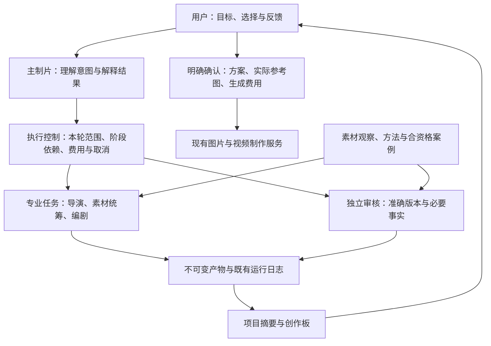

# 独立制片室 Agent 架构审查与优化

日期：2026-09-21。范围：US 独立制片室的视频创作 Agent。依据为本机当前工作树（包括此前未提交的开发修改）及 DeepSeek Harness 源码；没有读取真实业务聊天作效果抽样，没有发起真实模型或媒体生成。本文记录架构判断与代码改进，不是新的视频制作方案、采用决定或经营任务状态。

## 判断

当前应用已经有可用的业务骨架：版本不可变、上游变化使下游失效、角色读取范围隔离、独立审核、用户审批、调用台账和单写入进程。优先完善这些能力之间的执行契约。

最明确的问题发生在“模型说完了”和“业务工作完成了”之间：子角色成功提交后仍需要模型再回答一次；派工没有提交却返回普通成功字符串；工具定义与实际执行之间缺少统一能力检查。这会造成无用等待、错误恢复及完成状态不清楚。本轮已修复这些路径。

架构上适合采用“主制片负责对话和协调，专业角色承担有明确输入输出的短任务，独立审核保留，确定性程序负责状态与执行”的设计。当前 director/material/writer 本来就是按需启动、使用独立上下文的任务角色，应保留这种轻量形式。没有证据支持增加常驻 Agent、消息总线或多个会写同一项目的自治团队。

## DeepSeek Harness 的参考范围

检查版本：[`ddefc45fbc7f8e46dd73185e68295696d1297887`](https://github.com/deepseek-ai/deepseek-harness/tree/ddefc45fbc7f8e46dd73185e68295696d1297887)。固定提交便于后续核对，不能把后续 master 的行为当作本次检查证据。

| 一手资料 | 实际机制 | 本业务的用法 |
| --- | --- | --- |
| [架构总览](https://github.com/deepseek-ai/deepseek-harness/blob/ddefc45fbc7f8e46dd73185e68295696d1297887/docs/architecture.md) | 模型循环、能力接口、提供方、事件持久化和 UI 分层；通过 Cordis 组合插件 | 保留现有 Python 应用，逐步明确模块接口。换模型不改审核或审批规则 |
| [工具执行源码](https://github.com/deepseek-ai/deepseek-harness/blob/ddefc45fbc7f8e46dd73185e68295696d1297887/packages/core/tools/src/index.ts) | 工具受作用域约束；执行前策略和只会收紧权限的 guard；结果区分成功/失败，成功结果可带 concludesTurn | 工具能力在程序执行前核对；提交成功由后端标记完成，模型文字不能授予权限或宣布完成 |
| [调用调度源码](https://github.com/deepseek-ai/deepseek-harness/blob/ddefc45fbc7f8e46dd73185e68295696d1297887/packages/core/agent-loop/src/tool-calls.ts) | 调用/结果关联；结果按模型顺序提交；取消时明确记录未启动的调用 | 本应用保留顺序执行；完成后未执行的同批调用有显式结果，避免缺失配对。并非复制上游并行调度语义 |
| [请求重建检查](https://github.com/deepseek-ai/deepseek-harness/blob/ddefc45fbc7f8e46dd73185e68295696d1297887/packages/core/agent-loop/src/invariant.ts) | 校验发出的冻结请求与会话日志、请求头重建结果一致 | 已追加每次逻辑模型输入快照；不同于上游事件重建校验，尚不保证协议转换后的网络请求一致 |
| [项目说明](https://github.com/deepseek-ai/deepseek-harness/blob/ddefc45fbc7f8e46dd73185e68295696d1297887/README.md) | Developer preview，明确可能有破坏性兼容变更 | 当前不引入运行依赖；先吸收契约设计，避免给个人工作台增加迁移与运维负担 |

“Everything is a Plugin”解决能力组合与生命周期问题，不会自动解决带货创意、素材真实性或用户选择。插件化的价值应体现为可替换、可测试、可追溯，而不是插件数量。

## 发现与处理

### 已落地：完成条件由保存结果决定

原 `Dispatcher.run_role()` 成功执行 `submit_stage` 后会继续模型循环；普通 `run_review()` 保存 `finish_review` 后也会继续，只有显式审核命令已有提前停止。下一次请求如果失败，函数可能提前返回 error，主制片拿不到已提交的完整结果，尽管产物/审核已写入存储。

新增 [`ToolResult`](../studio/tools/execution.py)，由后端处理器返回 `content / is_error / concludes_turn`。成功提交和审核结束当前角色；`ask_user` 成功保存问题后等待回答。失败结果不能同时标记成功完成。同批后续调用标为未执行，所有工具调用均保留结果配对。

这可以减少每次原本需要收尾回复的提交/审核的一次模型请求；没有实测真实延迟或费用降幅。产物保存不代表审核通过，审核通过不代表用户采用；原审批仍生效。

### 已落地：工具显示与工具执行使用同一能力集合

原注册表按角色列出工具，具体处理函数各自拒绝未知名称。执行循环本身会把模型返回的任何名称交给处理器，未来处理分支与工具注册表有可能漂移。现有审批处理器并未因此对 Agent 开放，不能把这个缺口夸大成已经发生越权。

循环现在先检查本轮实际传入的工具名称集合和参数是否为对象，再调用处理器。业务字段、证据、路径、版本和审批继续由原领域层校验。这不是完整 JSON Schema 验证器，也不替代领域校验。

### 已落地：没有交付是失败，审核退回是有效结论

原派工通过 `DispatchOutcome.render()` 返回文本，即使失败或没有提交，循环仍记录 `ok=True`；审核没有判定也存在类似问题。现在主制片接收明确的失败工具结果；审核 `return` 是成功完成的审核，附具体 findings。已有相同版本的审核直接复用，不把“已审过”当成错误或再次花费。

### 已落地：新消息重新确定工作范围

第一轮审查发现 `creative_selection()` 读取最近一次持久化路由，没有记录时默认为 new/video。自然对话切换到状态查询后，旧制作意图有机会被沿用。第二轮已调整主制片入口：每条新消息先进入未选范围状态，初始 system 不把历史图文/视频格式当作本次结论；调用 `prepare_creative_context` 后才允许写稿、派工、送审、编译和准备制作。

本轮一旦选成 status/pause/feedback 或无交付，就不能同轮自行升级制作；下一条用户消息仍可明确续作。用本轮 ID 留痕，不改旧记录、不按关键词判断、不让用户填分类表。范围仍是模型对自然语言的解释，不能保证模型永远理解正确；它也不能赋予审批、图审或费用权限。专业派工内部沿用主制片刚选择的路由，直接 UI 审核仍依原明确动作执行。

### 已落地：完整逻辑请求留证

第一轮仅有方法快照、初始 system/messages hash 和截断的工具日志，无法准确复盘每一次请求。第二轮在 [`BudgetedClient`](../studio/agents/budget.py) 增加 [`requests.py`](../studio/agents/requests.py)：每次模型调用前，将完整逻辑 system/messages/tools、模型与公开路由标识保存到原 run 的 `requests/<call_id>.json`，绑定原台账 ID，内容哈希进入原事件日志。

输入先完整序列化、脱离可变调用参数，再用独占创建与 fsync 保存。记录失败不调用模型，已记 intent 按确认未调用结算为零；记录后取消同样不发请求。提供方已调用却失败时保留快照，未知用量仍为未知。诊断读取校验指纹与路径，不向 Agent 或任意 HTTP 文件入口开放，不注入另一角色或下次对话，不引入第二套任务数据库。

快照只在 Git 外原运行目录，记录实际模型内容，因此可能包含商品资料、用户对话及本轮适配器所需的私有响应字段；不序列化连接对象、API Key 或认证头。它是输入诊断证据，不是恢复私有会话的来源。尚未增加自动压缩或清理策略，长工具对话逐轮快照会增加磁盘占用。它也不是提供方协议转换后的 wire 请求，更不能证明请求已上网或内容正确；发送与费用状态仍以原台账记录为准。

### 已落地：返工角色能读到该改的原稿与问题

原专业角色只读上游，导致被派回修改时缺少自己上一版完整内容，也没有系统绑定的审核问题，容易重新写一份。第二轮在派工时固定本阶段上一版，核验指纹并注入修订基线；`read_artifact` 允许重读该准确版本，不能借此读取别人的对话或别的阶段。

审核问题只来自当前有效审核，且审核版本与产物指纹一致。下游问题还必须证明其输入引用了这份上一版，并只交付责任阶段匹配的 findings；过期审核、其他角色负责的问题不注入。事件保存基线版本/hash和问题来源。新审核继续独立读取新产物与必要事实，不拿旧判定或作者说明作答案。

### 能力缺口仍在：视觉策划角色名称不能代表看图能力

现有角色循环主要传文本；`list_materials` 读取文件及观察记录。应用另有图片观察能力，不能据此宣称每个角色亲自看过图片或理解过完整视频声画。素材统筹在四阶段中的位置也不能保证导演构思之前已经得到充分观察。

当前已有观察服务仍由用户明确动作触发，选用后的记录按既有证据规则进入角色上下文。本轮没有自动启动观察或改写该权限。后续应优先缩短必要素材观察进入导演输入的路径；构思后由素材统筹做可执行性检查。观察是可复用能力，不必再增加一个长期聊天的 Agent。当前视频声画理解与成片创意质量仍需实际样本验收。

## 第二轮：Agent 能力对照

本轮进一步检查 dsh 的 [子任务能力声明](https://github.com/deepseek-ai/deepseek-harness/blob/ddefc45fbc7f8e46dd73185e68295696d1297887/docs/subsystems/subagent.md)、[Skill 按需读取](https://github.com/deepseek-ai/deepseek-harness/blob/ddefc45fbc7f8e46dd73185e68295696d1297887/docs/subsystems/skills.md)、[计划与执行权限分离](https://github.com/deepseek-ai/deepseek-harness/blob/ddefc45fbc7f8e46dd73185e68295696d1297887/docs/subsystems/plan.md)和[上下文压缩](https://github.com/deepseek-ai/deepseek-harness/blob/ddefc45fbc7f8e46dd73185e68295696d1297887/docs/subsystems/compaction.md)。以下是适配判断，不表示 dsh 自带电商视频制作能力。

| 能力 | 原设计不足 | 当前处理与限制 |
| --- | --- | --- |
| 知道自己能做什么 | 工具列表可见，但模型能力、文件存在与实际观察容易混淆 | 所有角色有 `read_capabilities`，从注册表返回本角色真实工具及冻结模型路由；分开说明图片观察、完整视频理解和制作接口。只是应用接口声明，不伪称连接或模型已实测 |
| 使用方法与工具 | Canonical Skill 面向有 Shell 的助手，Studio 只开放业务工具；专业角色也没有补读方法入口 | 所有角色可按目录 ID 补读三份现有 Skill 与编译契约，记录方法版本；提示明确映射后台上下文、提交和编译能力。原研究、holdout及任意文件不开放，通用 Shell 未接入 |
| 延续并修订作品 | 只发任务和上游，角色拿不到自己上一版与绑定问题 | 已补准确旧稿、责任问题与版本约束，保留独立审核。无需常驻多个长聊天角色 |
| 找回长期对话 | 主制片初始只取最近 20 条，窗口外偏好不可主动读取 | 新增本 run 历史目录分页及原文分块读取，显示原始索引和后续游标；诊断信息被排除。历史不是本轮授权。尚未实现 dsh 的自动压缩与会话事件重建 |
| 分解任务并控制执行 | 旧路由可能跨轮沿用；提示词计划与执行许可易混为一谈 | 新消息重新确定范围，已收紧的本轮范围不能升级。阶段依赖、用户选择、参考图与费用仍由后端约束 |
| 看图与看听视频 | 视觉角色名不等于实际收到了图片/视频 | 已显式暴露限制；静态图观察仍用原服务和用户动作，尚无 Agent 完整声画理解工具。增加角色或更长提示词不能补齐感知 |
| 研究与实用工具 | dsh 的联网、文件和执行能力不能自动在 Studio 生效 | 本次保留业务工具范围，不给原始研究和生产者对话开后门。外部研究、自动试读、完整视频检视尚未接入，不宣称已能自行执行 |
| 学习与自检 | 自己写、自己解释、自己打分容易循环背书 | 保留现有独立审核和待审学习差异；新快照用于复盘输入。真实创意质量仍需样本评价，离线假模型不测说服力、表演或市场效果 |

本业务下一阶段的优先级是完整声画观察、可追溯的参考片理解和真实样本评估，随后再决定是否扩展研究或自动摘要。当前没有证据表明多设几个角色或整体换框架能优先解决这些问题。

## 适合当前业务的分层

这一图同时包含既有能力与上述目标接口，不能当作所有待办已实现。`W` 是代码职责，不是新增一个指挥 Agent；依赖现有 `Pipeline`、`JobManager`、`Ledger`，其中本轮范围约束已落地，但范围解释仍依赖模型理解。`P` 的角色可使用不同模型连接，但角色越多不代表质量越高。独立审核保持与生产者对话隔离；共用模型也可能共用偏差，需要样本评价而非自评证明。

用户继续从一句话与素材开始。内部整理、检查和修正由团队处理；用户决定真实创意取舍、最终方案、实际参考图与媒体费用。现有方向选择、脚本采用和图审的权限不因这张图合并或取消。

## 迭代顺序与验收

1. **本轮基础修正**：执行权限检查、明确结果与终止语义、提交/审核无需收尾请求。以离线行为回归验收。
2. **第二轮能力修正**：已落地本轮范围、逻辑请求快照、专业角色修订上下文、方法补读与旧对话检索；能力声明明确实际观察边界。以模型收到的准确输入及行为回归验收。完整声画观察和自动压缩仍未实现。
3. **后续实用性验证**：经具体授权后，用真实业务的“新创作、选非推荐方向、改一句话、查看进度、审核失败、素材变化”比较人工介入次数、正确完成率、已知调用成本及用户等待时间。与当前版本使用同输入作比较；没有足够数据前不声称角色数量或模型组合最优。

不迁移运行框架、不重建 Product Intel、不混入 SEA 事实、不自动启动真实媒体任务。飞书 Tasks 仍是经营任务状态事实源；本应用事件只记录本地执行与内容版本。

## 验证记录

改动前在临时 Python 3.12 环境运行：976 passed，2 skipped。环境按 `requirements-runtime.txt` 安装，另装 pytest；原文档 J 盘运行环境在当前机器不可用。全部业务测试使用假模型与临时目录，不使用真实 API。

第一轮改动后完整 Python 回归：988 passed，2 skipped，1 warning；Node 前端回归：259 passed。新增 12 个行为用例覆盖能力拒绝、非对象参数、终止后的调用配对与停止执行、提交失败修正、无需收尾响应、调用台账、审核结果复用及派工/审核无交付的失败反馈。原有冻结模型连接与权限测试继续通过；旧测试的假模型脚本及调用数量按省去收尾请求更新，没有删除测试或放宽业务门禁。

本地文档链接、文本编码与变更空白检查通过。未重启真实服务；下一次加载新代码时生效。没有真实模型、媒体生成或创意效果验收，不能据此宣称成片质量或商业效果提升。

第二轮改动后，当前工作树完整 Python 回归：1013 passed，2 skipped，1 warning（118.06 秒）；Node 前端回归：260 passed。本轮新增 21 项离线能力/请求用例，覆盖只读范围同轮不可升级、跨轮恢复、图文转视频不继承旧 system 约束、准确旧稿与责任问题、下游问题回传、过期审核排除、篡改阻断、旧对话分页/全文/隔离，以及每次请求完整留证、失败前不调用、取消与未知用量。此前涉及写稿/派工的假模型脚本增加显式本轮路由，断言仍确认真实子角色执行，避免测试因提前拒绝而虚假通过。

第二轮本地文档链接、文本编码与变更空白检查通过。所有测试继续使用假模型和临时目录；没有调用真实创作模型、没有制作或提交媒体、没有重启真实服务。代码在下次加载时生效，真实创意质量尚未验收。

## 第三轮：素材理解与参考迁移

已补视频稀疏画面分析、实际帧时间与像素绑定、观察/机制假设分离、用户采用后进入创作前证据整理，并建立固定业务场景及真实解码的合成视频测试。详细范围与验证见 [素材理解与参考迁移](material-understanding.md)。这是画面观察能力；音频理解、完整连续视频观察与真实创意质量仍未验收。

## 第四轮实现：按问题执行与局部修订

对应四点能力路线的第 3 点，新增原 Pipeline 派生的工作顺序、准确责任审核路由、当前轮版本绑定和程序执行的字段补丁。局部派工只开放补丁提交工具，旧内容与批准分别处理。详细行为、兼容限制与四点进度见 [按问题执行与局部修订](problem-directed-revisions.md)。该轮次编号不是成片验收已完成；完整声画理解和真正成片验收仍未实现。
