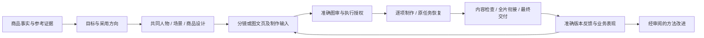
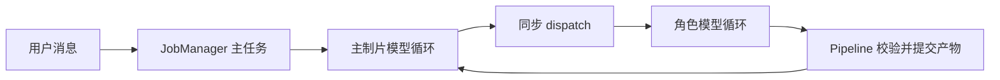
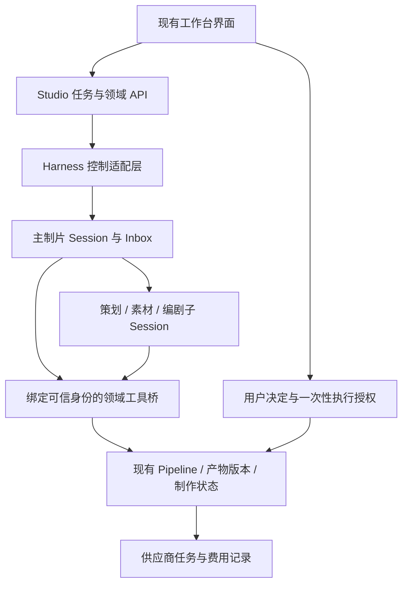

# DeepSeek Harness 与 Studio Agent 架构审查

审查及实施日期：2026-10-03。本文保留官方固定源码的首次研究、产品复核及后续路线选择。前文缺口与建议描述修复前基线；当前已在 Python 运行层借鉴会话、收件与协作机制，详见[实施后的路线选择](#实施后的路线选择2026-10-03)及[实现与验收状态](product-improvements.md)。没有切换到官方 Harness runtime、迁移项目或调用真实模型及媒体生成，现行授权和执行规则继续适用。

同日专项后续：[对话交互与用户指令控制审计](conversation-control-audit-20261003.md)。该审计复现了忙时用户消息身份丢失、进度问句未投递却标已回答、直接修改命令降级及草稿绑定丢失等问题，并补充首次范围约束和跨角色条件继承的实施与验收边界。

## 判断

**Studio 确实有运行时层面的结构缺口，继续只改角色提示词和界面不足以解决。建议优先验证直接复用 DeepSeek Harness 的会话、消息队列和子 Agent 运行时，保留 Studio 的创作产物、版本、审批和制作系统。**

这不是“角色数量不够”。我们已有真正的角色模型循环和工具权限，但子角色主要作为主任务的一次同步函数调用存在。用户插话、取消、任务结束和恢复都压在同一个 Job 上，导致一次自然交流可能改变整轮任务生命周期。应先改变这个边界，再考虑更多角色或并行度。

DeepSeek Harness 也不能直接整包替换：审查版本仍是 RC；实验性 Team 有明确限制；Python SDK 暴露的控制能力不足以承接整个工作台。推荐先做隔离的完整流程验证，用实际接入成本决定采用，而不是先重写现有项目。

## 第二轮复核：以完整创作产品为基准

**上一轮偏重“Agent 如何运行”，对“作品如何持续保持正确”覆盖不足。** 复核后的目标是：用户给出商品和创作要求，工作台持续维护正确依据和作品版本，主动完成已授权的准备工作；遇到真正需要决定、授权或补充事实时清楚停下；用户修改一个部分后，系统知道应该更新什么、保留什么，并最终交付可检查的作品与复用经验。

该目标来自[项目目标与阶段关系](../../../docs/project-vision.md)、当前 `CLAUDE.md` 及已有产品能力。它同时覆盖视频、图文、参考拆解和局部修改；只分析或只要提示词的任务按相应交付结束，不强制经过完整视频链。理想状态不扩张为本轮建设多租户平台、自动发布或另一套 Product Intel。

### 先校正对现有系统的评价

- **输入审计已有实现。** `BudgetedClient` 在调用前保存完整逻辑 `system/messages/tools`、模型及路由，并绑定 `call_id` 和哈希；保存失败不发请求。因此不能说 Studio 只存聊天文本。缺口是这些记录尚未组成可独立继续的子会话、完整执行事件和恢复协议；逻辑快照也不等于提供方 wire 请求或已发送证明。[调用前记录](../studio/agents/budget.py#L62)、[快照保存](../studio/agents/requests.py#L14)
- **共同视觉设计已有实现。** 当前有人物、场景、连续性、地域和商品外观字段，脚本引用实体 ID，实际制作输入重新编译并冻结设计版本。需要检查实际输入与生成画面是否贯彻，而不是再造一个“人物设计 Agent”或平行设计库。[视觉契约](../studio/visual_design.py#L14)、[角色上下文](../studio/task_context.py#L45)
- **局部修改与依赖检查已有实现，但粒度受限。** 当前能约束已有文字字段、保留旧稿和核验上游；不能据此宣称跨版本插镜、删镜、重排和媒体局部复用已经解决。[局部修订边界](../studio/revision_scope.py#L78)
- **方法和业务反馈已有基础。** 方法正文与学习上下文可保存快照，学习差异需用户采用，作品表现有来源和时间口径。需要补强版本关联和效果验收，不应以通用 Agent memory 替换这些规则。[方法读取](../studio/learning.py#L427)、[表现记录](../studio/outcomes.py#L39)

### 理想产品的主链路与责任

这是作品的依赖关系，不是要求模型每次从头跑一遍，也不是新增九个 Agent。主制片负责理解任务、编排必要工作和解释下一动作；现有专业角色按交付需要参与。系统自己完成角色交接、版本绑定和技术检查，不把内部表格、派工和反复“继续”交给用户。

### 需要借鉴或补强的能力清单

下表的 P0 表示接入前必须证明的正确性；P1 表示形成低介入完整工作流需要的能力，不代表已授权立即开发全部功能。

| 优先级与产品能力 | 理想行为及现有基础 | 借鉴范围与需要自己负责的部分 |
| --- | --- | --- |
| P0：任务目标与完成标准 | “写脚本”“补第 3 镜”“只拆解参考”有不同完成条件；Agent 结束、输入准备好、媒体返回、内容可用分别表达。已有 `task_contract`，自由对话目标缺省仍有漏洞 | 借 Session/turn 生命周期；任务目标、有效产物与完成判定由 Studio 从领域状态检查，不能由助手最后一句或 `idle` 决定 |
| P0：持续有效的项目上下文 | 长对话、重启和换角色后仍知道商品哪一款、采用哪版、明确否决了什么、当前缺什么。已有 ActiveBrief、证据与任务上下文 | 借 token 计量、分段压缩和恢复机制；当前决定、授权、事实及准确产物引用每次从可信领域状态装配，不能仅依赖摘要记忆 |
| P0：真实视觉依据 | 每次判断能追溯实际送入的商品图、角色图和视频时间范围；“有文件”与“模型看过”分开 | 借内容寻址、附件校验和请求版本；保留 Studio 原始素材及观察用途，绑定原件和实际送入副本，保护本轮必需图不被自动卸载 |
| P0：角色/场景/商品一致性 | 各镜共享同一设计，具体生活环境、交流方式与购买处境符合美国线；生成结果需要实看。已有 `visual_design` 和编译输入 | 借角色作用域、精确输入和产物回执；共同设计、跨镜一致性、市场适配与内容判断是创作领域能力，Harness 不提供答案 |
| P0：安全的工作中对话 | 问进度不中断；改要求先保存原话并明确作用范围；停止后旧调整不偷偷继续；迟到结果仍可追溯 | 借 inbox、步骤边界、取消与子任务所有权；Studio 定义停止范围和接续语义，UI 保持清楚的停止入口，不让用户理解内部调度 |
| P0：长媒体任务 | 对话结束或页面关闭后，已提交视频身份仍存在；已生成但下载失败可取回；结果未知不重发 | 保留并整理现有 `production.py` 持久记录与恢复逻辑，形成独立于 Agent 激活状态的媒体执行组件；不用 Harness 内存 jobs 代替 |
| P0：准确决定与收费 | 创作采用、图片确认、收费提交各绑定实际看到的版本；只读打开项目不启动模型；反馈不自动获得制作授权 | 保留当前唯一决定入口、一次性 Execution Authorization、世代失效与提交时校验；Harness 工具权限只是额外约束，不能替代这些领域检查 |
| P0：跨运行时可靠交接 | 产物已保存但回执丢失时只找回原版本；同命令重送不多写、不多收费；同 ID 换载荷被拒绝 | 借事件序号、回执、投影与去重模式；Python 保持领域命令唯一受理者，桥接保存准确载荷指纹和结果关联，处理持久保存与通知之间的中断窗口 |
| P1：作品对象与局部返工 | 反馈绑定正在看的图片/镜头/脚本版本；改一镜先计算影响，保留有效内容；插镜或重排不把另一镜当原镜 | 借有版本的任务依赖及冲突检查理念；独立镜头/页面身份、依赖图、失效范围与复用判断由 Studio 负责，不能用 Team task board 代替 |
| P0：内容质量与完整交付 | 不仅能解码，还需检查商品真实、人物场景、动作、声音、表达推进和相邻镜头衔接；视频、封面、文案与剪辑来源对应实际交付版本 | 借结构化输出及校验钩子；内容证据、检查覆盖和集中补救留在业务层。沿用作者/主制片自检，不恢复已停用的独立审核 Agent，不增加形式审批 |
| P1：方法、模型与成本可追溯 | 知道哪版方法和哪条模型路由产生哪份结果；失败、压缩与重试的开销也可归因；未知不填零 | 借按需 Skill、适配器和事件关联；保留方法正文/资源 hash、冻结连接和价目、原 ledger。当前不新增全局 token/金额额度或手工核账要求 |
| P1：面向作品的状态与排障 | 画布展示商品/设计/分镜/真实结果及下一动作；卡住时可区分等模型、等用户、供应商处理中、下载失败、输入失效 | 借快照与连续事件、统一身份链；创作画布和对话读取同一领域投影，开发日志按需查看，不把它的 coding UI 当成创作者界面 |
| P1：反馈学习与经营验证 | “这张图不对”先关联准确输入和输出，区分方法问题、商品事实、偏好、模型执行失败；真实表现绑定实际作品再判断 | 借可重放场景与来源链；沿用 US 学习库、差异审核和作品表现登记。单次成功或模型赞同不能写成有效方法；不另建采集管线 |

### 本次补出的关键细节

**1. 创作任务、Agent 会话和供应商任务必须分别存在。** 建议明确关联链 `run → creative task → role session/turn → production attempt → provider task → output/version/hash`。界面从这些事实组合状态：Agent 空闲但视频未回，仍是“生成中”；供应商完成但下载失败，是“待取回”；结果齐全不自动等于内容合格。[现有完成检查](../studio/task_contract.py#L46)、[现有视频执行](../studio/production.py#L1700)

Harness 的 `jobs-local` 将状态、输出与游标存于内存，Agent/service dispose 会取消并删除 job；取消器异常时甚至只能标记可能遗留的外部工作。这是运行时后台作业设施，不能承担我们的持久媒体生产契约。[后台作业实现][jobs-local]

**2. 压缩是管理上下文，不是保存业务决定。** Harness 会保留旧会话事件，通过替换投影压缩历史，并验证摘要生成期间选中范围未变化；机制值得复用。默认摘要模板面向编程，不能保证准确保留获批商品、脚本、角色图和用户否决。应为创作配置适用摘要，并始终从领域状态补充当前有效引用；摘要不能产生新的批准。压缩会额外调用模型，其成本也应进入调用记录。[压缩模板][compaction-prompt]、[压缩一致性][compaction-region]

**3. 图片卸载与归一化会改变实际观察条件。** Harness 会规范化图像并为请求生成适配版本；图片超限时，默认卸载策略按先后顺序把旧图换成占位文字，不理解哪张是当前商品或获批人物基准。创作关键图必须按本轮任务保留或重新读取；做不到时应明确缺少观察依据。原图、观察副本和用户实际获批图的字节身份不能混用。通用附件存储也不等于听过音频或分析过视频。[附件契约][attachments]、[卸载实现][image-offload]

**4. 现在的镜头 ID 有适用范围。** `target_shots` 按脚本段落顺序生成 `shot-01/02…`；它能在当前脚本和来源指纹下定位制作，不能保证在新稿插镜、删镜、重排后仍表示同一对象。理想状态应把镜头持久身份与显示顺序分开，再支持跨版映射、依赖影响和局部复用。旧结果可以保留为候选，但旧批准不能因此自动迁移。[目标镜头实现](../studio/production.py#L519)

局部复用须区分“素材字节仍可复用”和“新上下文已获批准”。改一句文案不应盲目重做所有视觉素材；更换商品、共同角色、场景或动作衔接时，也不能因为某字段没改就维持有效。先完善依赖证据，再缩小现有保守失效范围。

**5. 计划中的画面不能被误当成写脚本前必须已有的商品证据。** 商品性能或关键外观缺证据可以阻塞相关表达；尚未生成的场景画面通常是制作待办。当前 `material_blockers` 会影响素材计划完成和下游可启动性，应专项验收“缺画面 → 脚本不能写 → 脚本未采用 → 画面不能生成”是否出现。代码支持这一类阻塞条件，但本轮没有历史实例归因；不能将它写成已复现线上死循环。[素材阻塞](../studio/structured.py#L465)、[阶段完成条件](../studio/pipeline.py#L291)

**6. 结构化工具输出仍需落在领域存储。** Harness 明确将 canonical 工具值视为 execution-local，不纳入持久事件；持久工具消息不等于保存完整业务对象。先由 Studio 原路径保存准确产物，再交回引用、版本/hash 和摘要。模型看到的摘要、UI 元数据和正式产物分开，截断工具输出不能被误报为产物生成失败。[工具结果契约][tool-value]

**7. Skill 目录变更不等于方法内容版本。** Harness 的目录 hash 只覆盖名称与描述，加载结果没有自动附带正文/资源版本。应复用按需加载和角色作用域，同时继续使用 Studio 的方法快照与证据资格过滤。“方法在目录里”不能当成“这次角色确实读取并使用了它”；案例、holdout、网页内容也不能提升为系统权限。[Skill 加载][skill-load]、[目录 hash][skill-digest]

**8. 模型能力、成本与运行时状态要分别核验。** 借用适配器能力声明和同一步路由一致性，保留本产品每轮冻结连接/模型/价格的规则；不照搬运行中随意换模型，也不自动降级到无法看图的模型完成视觉任务。Harness token 压力投影明确不能用于计费或放行；账本必须覆盖主角色、子角色、压缩、重试、观察与媒体调用。未知费用继续记未知，媒体提交结果未知继续只查原任务，两者不能混为一谈。[当前连接冻结](../studio/connections.py#L267)、[token 投影边界][token-pressure]

**9. 诊断链和产品质量评价需要一起建立。** 运行问题应能关联项目、用户原话、任务、角色、工具、供应商请求和产物，显示最后一条真实进展及可执行的下一步。完整 trace 默认只用于受控本地排障；Harness telemetry 的脱敏扩展点不自带规则，不能直接把原始事件外传。创作效果另看代表性样本的内容证据、合格结果总成本、用户纠错与人工介入，不能用日志完整或工具回放通过替代。[telemetry 边界][telemetry]

### 借鉴取舍与修订后的接入路线

| 取舍 | 具体范围 |
| --- | --- |
| 优先复用的运行机制 | Session 持久化/所有权、Inbox、子 Agent 启停和继续、工具 schema/作用域/结果回执、事件投影、可取消的适配接口、会话回放测试 |
| 需要适配后使用 | 创作上下文压缩、附件归一化与卸载、Skill 加载、模型错误/重试策略、取消范围、事件脱敏和媒体状态显示 |
| 继续由 Studio 负责 | 商品与参考证据、ActiveBrief、视觉设计、对象版本与依赖、交付验收、真实用户决定、执行授权、媒体任务和 ledger、学习/经营反馈 |
| 当前不引入 | 实验性共享 Team、角色任意互聊、默认 coding shell/全文件写入、完整另一套产品 UI、自动媒体重试、自动学习入库、跨线路共享事实 |

**修正上一轮对 web profile 的推荐力度。** 完整 web profile 可以作为隔离能力探针，但不能预先定为生产集成方案。Session Controller 已依赖上传、附件、文件系统、workspace 等多项服务，完整 bundle 又包含终端、设置、账户与 UI；Python 接入还需要其 RPC/流协议。应优先评估自定义无界面 profile 加薄 TS 适配插件，复用核心能力，只暴露 Studio 所需的启动、发送、范围停止、读取、订阅和显式恢复。该组合是否足够轻量尚未实测；需要大改核心时停止直接集成路线。[控制面依赖][controller-deps]

跨进程交接应有 `command_id + payload_hash + expected_revision + receipt`，领域层先持久保存结果，再可靠通知会话；补发通知不得重做领域动作。可在现有事件/命令存储中实现待投递记录与去重，不预设引入消息队列服务或第二套任务数据库。保留单领域写入者，模型读取和无冲突子任务可有限并行。

正式迁移需同时固定 runtime、profile、工具 schema 和桥接版本。回退时不得从旧数据快照重新提交已经在新版本提交的媒体；软件回退与业务数据回滚是两件事。原项目先可读、可查回原任务，不能为了接入而清理历史。

### 以产品情境验收，扩大原先的一条派工试验

只证明“主 Agent 能派一个子 Agent”不足以采用新运行时。第一条隔离流程应带商品、共同设计、多个镜头、一次修改、一次状态查询和一次未知媒体结果，再验证以下场景；均先使用明确的假模型/假供应商，不污染真实项目：

| 场景 | 必须观察到的结果 |
| --- | --- |
| 只分析参考 / 只要提示词 / 图文 / 视频 | 交付范围正确，不因复用工作流强制多走阶段或擅自制作 |
| 用户提供商品图，连续讨论并经历压缩/恢复 | 当前商品、方向、否决项、图审版本及待办仍一致；所需关键图实际进入请求 |
| 共同角色与美国生活场景跨镜复用 | 各镜引用同一设计及真实输入，缺设计时明确准备；离线只验输入，画面质量另验 |
| 在第 2 镜前插入一镜，再改原第 3 镜 | 修改准确对象，顺序变化不偷换身份；未受影响结果有可说明的复用依据 |
| 点击旧图反馈、修改一镜、回到当前项目 | 原话绑定用户看到的原图和版本；明确后继对象，保留正确内容及旧版，禁止冒充已重新获批 |
| 计划生成的画面尚不存在 | 可先写合法方案；真正缺失商品事实才阻塞相应表达，不形成创作依赖循环 |
| 问进度、修改要求、停止与迟到回调交错 | 原话不丢、不误取消、不偷偷接续；实际完成的外部动作仍保留并正确解释 |
| 供应商已接单但响应丢失 / 下载失败 / 本机重启 | 不产生第二次提交，查询同一任务；无法核实时保留未知，不伪造失败或成功 |
| 产物提交成功但 Harness 未收到回执 | 找回同一产物并补通知，不生成重复版本；相同命令 ID 的不同载荷被拒绝 |
| 旧版本批准、A→B→A 源变化、跨项目工具请求 | 授权不复活、不跨项目；可信身份在恢复与角色派生后仍成立 |
| 单镜都完成但整片声画/文案未对应 | 保持具体交付缺口；成片、caption、剪辑来源和输入版本可一起核对 |
| 方法更新、模型能力变化、反复失败与运行时升级 | 快照可追溯、不静默改能力/费用范围、不靠换 task_id 重试；升级回退不重复消费授权 |

Harness 的 session-snapshot 工具支持无密钥 replay 和独立子会话 fixture，可借鉴这类测试结构。当前 Studio 已有请求快照和契约测试，应沿现有结构增加上述情境，不另造一套只验证框架内部实现的测试。[回放支持][replay-harness]

通过离线故障情境后，再按已有授权边界做代表性真实创作验收。评价分开记录运行稳定性、内容合格与业务表现；指标包括每次合格交付的总成本、重复制作、用户纠错/人工介入及未完成原因。历史调参案例和未参与调参的新样本分别报告；未发布时不推断流量或成交效果。

实施顺序建议为：**先明确对象/状态/命令契约与代表性验收，再做最小运行时接入；同时保住上下文、视觉依据和媒体恢复；最后扩展跨版局部复用与反馈学习。** 不把更多 Agent、全部并行或整套框架迁移本身当成产品改进的证据。

第二轮实际完成了代码与产品契约复核、来源核对及本文修订；未新增行为实现、未运行 Harness、未运行上述尚未实现的情境测试。第一轮两项离线复现结果沿用并明确标注，没有再次冒充本轮新验证。

## 源码已下载并固定版本

| 项目 | 记录 |
| --- | --- |
| 官方仓库 | <https://github.com/deepseek-ai/deepseek-harness> |
| 本次固定提交 | `639ed015397290b3745d163aafe02ffee4aa3f84` |
| 提交时间 | `2026-09-29T09:21:31Z` |
| 根包版本 | `0.2.0-rc.2` |
| 完整源码目录 | `D:/projects/_references/deepseek-harness-639ed015397290b3745d163aafe02ffee4aa3f84` |
| 原始归档 | `D:/projects/_references/deepseek-harness-639ed015.zip` |
| 来源清单 | `D:/projects/_references/deepseek-harness-639ed015.source.json` |
| 归档 SHA-256 | `ee17162f19fbed3161a5ec04985a86c5aa2050262ea3dcf019f03579441c8b90` |
| 校验 | 43,046,027 字节；ZIP CRC 通过；解包路径检查通过；14,104 个文件 |
| 许可证 | MIT；后续复制代码须保留适用版权和许可证声明 |

Git 两次传输均未完成 checkout，最终下载了指定提交的[官方完整源码归档][archive]。这是可审查的完整源码快照，不是完整 Git 工作副本；没有安装依赖或运行其中代码。参考源码在业务仓库外，不会混入 Studio 提交。

## 它的 Agent 架构如何工作

DeepSeek Harness 用 Cordis 插件组合运行时。真正值得借鉴的是以下职责边界，而不是插件数量或文件组织形式。[架构说明][architecture]

| 层 | 负责什么 | 对 Studio 的意义 |
| --- | --- | --- |
| Session | 持久化会话事件，重建模型消息和会话状态 | 运行记录应能重建当时的模型输入与工具结果，而不只保留用户/助手聊天文本 |
| Agent loop | 从 inbox 接收输入，发起模型步骤，执行工具，收尾本轮 | 用户插话不必等同于取消整个任务 |
| Inbox | 区分下一轮输入、下一步骤的调整和不唤醒通知 | 查询、调整、继续、停止有各自生命周期 |
| Tools | 工具注册、上下文、执行拦截和并发类别 | 可并行读取；修改共享状态的工具保留独占边界 |
| Subagent | 子会话身份、父子关系、启动、通信、恢复和释放 | 角色成为可观察、可继续的任务参与者 |
| API / projections | 历史、状态投影、事件订阅及控制命令 | 刷新页面可以重新获取状态，不依赖旧前端内存 |

### 消息、停止与恢复是独立概念

`followup` 将消息放到下一轮并唤醒；`steer` 放到下一步骤并唤醒；`inject` 放到下一步骤但不主动唤醒。`cancel` 另外决定是否保留 inbox，再发出协作式中断。[Agent 实现][agent]

Inbox 的修改本身是可持久化事件；恢复时先取得该 Session 的写入所有权，读取记录，再给中断中的轮次追加缺失的工具错误、步骤结束和轮次结束记录。这使“恢复哪一份状态、由谁继续写”成为程序契约。[Inbox][inbox]、[恢复实现][resume]

这仍不是对外部副作用的事务回滚。已经提交的视频任务不能因为本地 Agent 被取消就假定供应商取消；进程突然消失前尚未结算的流式输出，也不能假定全部可重放。

### 工具并发由运行时约束

只有明确被工具规则认定为安全并行的调用，才进入有界并行池；未声明、判断异常或无效返回会归入独占执行。独占工具形成执行屏障，工具结果仍按模型调用顺序提交。[并行调度][tool-calls]、[分类默认值][tool-concurrency]

因此，借鉴方式不是给现有 `Dispatcher` 套一个线程池。应先明确哪些动作只是读取，哪些动作修改同一产物、推进审批或提交制作；后者继续由领域层串行校验。

### 对话日志与界面状态有共同来源

模型请求通过 Session 消息投影组装，并有 invariant 检查实际消息、请求头和工具集合是否与记录一致。通用 projection 可跟随已提交事件增量更新。[请求一致性][invariant]、[状态投影][projection]

API 的 `follow` 先提供快照，再交付连续序号的事件；当前接口不是客户端随意提供 `afterSeq` 的重放协议，重连应重新采用快照。`page` 可读冷会话历史；`follow` 某些冷会话时会推动后台激活，不能将所有订阅操作当成完全没有执行影响的读取。[历史与订阅][history]

## 它的多 Agent 协作有两套机制

### 常规 Subagent：更适合当前创作工作台

常规子 Agent 分为一次性和可继续两类。一次性子任务返回最终结果；可继续子任务拥有持久 Session 和稳定 ID，同一时刻至多一个进程内 Activation，支持后续消息、打断和冷恢复。[Subagent 契约][subagent]

父子间通信校验真实的存活 Agent 身份和关系。父 Agent 可以给直接子 Agent 发消息；常驻子 Agent 可以向直接父 Agent 回报。运行中的接收者在步骤边界接收消息，空闲接收者可被唤醒；这不等于所有角色都能任意互相发送消息。[身份与路由][continuation]

它还把以下问题写进运行时：

- 创建完成必须意味着真实子任务已经存在，不能先返回一个看起来成功的空身份。
- 活跃子任务数量和委派深度分别约束；容量满时明确拒绝，不无限排队。
- 会话历史与当前激活状态分开，结束一轮不必销毁角色身份。
- 子任务列表从父会话的 catalog 读取，查看状态无需启动子任务。
- 可用能力取决于 provider；不支持的恢复、选项或继续方式应在启动时失败，不能静默忽略。

对 Studio，默认结构仍可保留主制片、策划、素材和编剧。先让这些角色拥有清楚的输入、交付、状态和独立恢复点，比增加角色更有价值。产物交接继续使用版本、指纹和结构化引用，不必把每个角色的完整私有对话传给所有人。

### 实验性 Team：共享任务板和成员间通信

Team 在 Lead 会话日志里保存成员、邮箱和任务板。成员可相互通信；任务有依赖、负责人和 revision，更新按 compare-and-set 拒绝旧版本，依赖完成后才能认领。待机成员可接收持久化待办消息。[Team 说明][team]、[任务板实现][task-board]

但应明确边界：

- 包名明确是 `experimental`，没有稳定性承诺。
- 协调处于单一进程，所有成员共享工作目录；不提供跨进程一致性或自动工作树隔离。
- 文件写入范围只是冲突提示，不是文件锁；不能靠它保护获批脚本。
- 中断成员不会自动释放任务所有权，也不删除待办消息。
- 邮箱通过持久化、重试和去重保障交付，不能扩大解释成跨进程外部副作用“恰好一次”。
- Team 当前每次读取会重放其 Lead 日志，不能把通用增量 projection 的性能性质套给所有组件。

**建议先接常规 Subagent，暂不引入共享 Team 任务板。** 当前主要缺口是执行生命周期和恢复；暂未发现需要角色任意互聊、共同争抢创作任务的产品需求。

## 我们当前的问题：哪些已证实，哪些只是风险

当前调用链为：

角色确实有独立模型循环、提示词、工具集和 attempt，不能说只是换名字的单 Agent。限制在于它们共用父任务的执行线程和取消机制，没有可独立继续的完整子会话。当前单活动 Job 的限制是个人本地工作台的取舍，本身不等于错误；问题是它同时承担了模型运行、业务交付和用户输入控制。[本地派工](../studio/tools/dispatch.py#L141)

### 已复现 1：进度问句会落入修改分支

直接运行当前 `steer_intent.classify`，结果如下：

| 输入 | 实际分类 |
| --- | --- |
| `进度怎么样` | `status` |
| `啥情况，还在做吗，怎么这么久` | `work` |
| `你看下现在的状态，好像跟卡住了一样` | `work` |
| `图回来没` | `work` |
| `生成完了吗` | `work` |
| `只是问一下还在跑吗` | `work` |
| `停止` | `stop` |

未命中现有词句规则的内容默认归为 `work`。在任务运行期间，这类输入进入 `needs_stop` 分支并置取消信号；旧任务结束后，待处理的工作输入又可能触发接续。[分类器](../studio/steer_intent.py#L89)、[取消入口](../studio/jobs.py#L370)、[接续](../studio/jobs.py#L514)

这些语句来自用户的自然表达，将其输入分类器证明了缺口；**没有据此断言历史每次卡住都是这条路径造成的**。本轮未做历史运行事件归因。

借鉴重点是用持久 inbox 承接消息，取消成为明确动作；不能只再加几个“进度”关键词。Harness 只提供机制，不会自动替我们正确理解所有中文输入。

### 已复现 2：动态任务编号绕过重复失败识别

现有循环用 `(工具名, 工具结果文本)` 聚合同样的失败；派工 receipt 包含每次不同的 `task_id`，导致业务上相同的失败被计成不同失败。[失败统计](../studio/agents/client.py#L521)、[receipt](../studio/tools/dispatch.py#L55)

使用真实 `run_agent_loop` 和 `DispatchOutcome.receipt`，仅替换模型与工具执行为明确的内存假对象，进行对照：

| 条件 | 假派工次数 | 停止原因 | 不同失败 key 数 |
| --- | --- | --- | --- |
| 相同任务和错误，每次新 `task_id` | 5 | `max_rounds` | 5 |
| 相同任务和错误，固定 `task_id` | 4 | `repeated_failure` | 1 |

这证明失败归类存在缺口，不证明线上发生了五次同样的收费调用。现有取消、预算/预检拒绝以及部分连接和响应异常已有强制停止分支，应保留。[已有保护](../studio/tools/dispatch.py#L283)

Harness 的重复工具提醒按“工具名＋规范化参数”识别，避免依赖含动态身份的输出；但它只提醒模型，**不会强制阻断**。我们仍需用稳定的操作身份与错误类别执行不可重试规则；不能复制这个插件后就宣称消除了循环。[重复提醒实现][repeat]

### 静态确认：自由对话缺少强制交付契约

系统提示要求设置交付目标，但 `prepare_creative_context` 的 schema 允许省略 `deliverable`。缺省时主制片完成检查可以不执行明确的交付判定，任务状态为 `unspecified` 的路径仍可能被 Job 视作成功。这会留下“聊完了是否等于任务完成”的空隙。[工具 schema](../studio/tools/registry.py#L190)、[完成检查](../studio/agents/orchestrator.py#L458)、[状态判定](../studio/task_contract.py#L95)、[Job 收尾](../studio/jobs.py#L451)

此结论仅针对自由对话入口。明确阶段命令会绑定阶段和版本，验证 `outcome.submitted`；部分观察工具会直接设置交付目标，Pipeline 也在提交时重新检查上游指纹。应把这些已有的硬契约推广为服务端任务对象，而不是削弱它们。[阶段命令](../studio/server.py#L138)、[提交检查](../studio/pipeline.py#L508)

### 结构缺口与尚未测量的风险

| 观察 | 已有证据 | 结论边界 |
| --- | --- | --- |
| 一个活动 Job 和共享取消事件 | `jobs.py:126`、`:309` | 并发和取消范围很粗；不等于必须开放无限并行 |
| 重启将未结束 Job 标记为 interrupted | `jobs.py:140` | 可以说明中断，但没有独立恢复子角色会话的能力 |
| 活跃会话缺少独立续跑协议 | `agents/client.py:389`；`orchestrator.py:556` 读取有限聊天窗口；`agents/budget.py:62` 保存每次逻辑请求 | 已有完整逻辑输入快照、事件、指纹和产物审计；缺的是串联执行事件的可恢复会话，不是输入审计空白 |
| 部分写入或读取会重扫日志 | `store.py:199`、`jobs.py:185` | 存在增长后的成本风险，本轮没有性能压测或新死锁复现，不据此解释当前卡顿 |

界面刷新跳首页、弹窗内反馈按钮无可见响应等问题，仍需各自的前端状态与交互修复；不能一概归咎于 Agent 架构。供应商连通性也不能靠换调度框架自动解决。

## 接入路线：保留领域层，验证替换运行时

运行时负责“谁在执行、收到哪些消息、当前哪一步、如何恢复”；Studio 负责“作品是什么版本、是否采用、哪些镜头完成、能否收费提交”。两者用 `run_id`、`task_id`、`session_id` 和产物引用关联，各自只拥有自己的状态；不新建第二份审批、镜头覆盖率或供应商任务真相。

必须保留：不可变产物、准确版本与指纹、源事实世代、提交时上游复核、角色工具权限、唯一用户决定写入口、独立 Execution Authorization、共享 `target_shots/coverage` 投影、未知提交只查询原任务的规则。

### 为什么不能只装 Python SDK

固定提交的 SDK 协议只公开 `initialize`、`session/prompt`、`shutdown`。它能启动并复用子进程、收会话及子 Agent 通知；没有足以承接 Studio 的单会话取消、显式恢复、历史读取和 Python 工具回调注册契约。服务端新建会话使用 `agents.create`，不能将“重启后用同 ID 发消息”当成恢复保证。[SDK 实现][sdk]

SDK 要求 `pydantic>=2.12,<3`，当前 Studio 固定 `2.9.0`；源码中的 SDK 与 runtime-bin 版本还是构建占位 `0.0.0.dev0`。不可直接装入现有运行环境。[SDK 依赖][sdk-deps]、[Studio 依赖](../requirements-runtime.txt#L6)

官方 Session Controller 更接近所需控制面：创建/采用、queue/steer、取消、历史、订阅、投影和 live control。它使用自己的 RPC 包装和 WebSocket 多路流，需要适配，不能冒充现成 Python REST 客户端。[控制面][controller]

第二轮已将 web profile 降为隔离能力探针；正式接入优先评估自定义无界面 profile 与薄控制适配层，具体成本需验证，详见上文。部署前仍须核对插件和工具暴露：默认 coding 工具不应获得任意修改 Studio 数据或授权的能力。`sdk-minimal` 也不等于受限多 Agent 产品模板，它并不包含所需的 Subagent 组合。

### 两个必须适配的语义差异

1. **停止语义。** 官方 `session/cancel` 使用 `keepInbox:true`，仅表示接受取消请求，保留待办消息。Studio 明确停止需要丢弃尚未接续的旧调整，不能随后自动再跑。适配层必须让清队列与取消具备明确顺序/并发契约，等待执行真正收尾，并把“供应商任务仍在处理中”单独展示。[取消实现][cancel]
2. **可信工具身份。** 通用 MCP 调用只转发工具名和模型参数，不自动注入可信的 Studio 项目/角色。不能让模型自行填写任意 `run_id`。应使用每会话/角色受限的 MCP 实例，或由薄 TS 插件从实际执行 Agent 注入服务端绑定，再由 Python 复核权限、版本与指纹。审批和费用授权不进入模型可自行执行的工具集。[MCP 转发][mcp]、[当前绑定](../studio/tools/dispatch.py#L170)

## 迁移顺序与退出条件

| 路线 | 收益与成本 | 判断 |
| --- | --- | --- |
| 将 inbox / session / 子任务机制重新写成 Python | 不引入 Node 服务，但仍需长期维护自己的运行时和恢复逻辑 | 若官方扩展边界承接不了领域规则，再选这条 |
| 复用 Harness 运行时，以薄适配层接 Python 领域工具 | 能复用会话、子任务和恢复；付出进程管理、协议适配和版本升级成本 | 优先做隔离验证 |
| 整体改用其产品和存储模型 | 会重做已有效的版本、审批、镜头、授权和制作规则，现有项目迁移风险最大 | 目前无证据支持 |

**第一步：把本次发现变成运行时验收条件。** 固定进度查询、明确停止、重复失败、交付缺失四类行为。不要用扩充提示词代替这些硬条件，也不引入新的用户逐项审批负担。

**第二步：隔离验证一条完整路径。** 固定本次 commit、独立运行目录与 `DSH_HOME`，用假模型和假制作工具跑通产品情境。第二轮已扩大最低验收范围：包括准确商品/共同设计、多个镜头、局部修改和未知媒体结果，不能只以一次派工成功验收。原项目、连接配置和运行数据不进入试点写路径。

**第三步：通过后再考虑新项目切换。** 新任务明确选择一个运行时，旧项目保留原执行记录和审批；领域产物可由受控读取提供给新会话，但不得重放历史收费动作、恢复取消任务或伪造审批迁移。运行时切换必须可回退到原适配器，不能要求先转换全部历史数据。真实模型和媒体测试的费用另行按现有规则处理。

退出条件：若为了遵守 Studio 的停止、工具身份和授权规则，必须长期修改 Harness 核心或维护大量私有分叉，则停止直接集成路线；将本次已确认的机制移植到现有运行时。当前静态调查还不能证明直接采用一定更便宜。

### 隔离验证必须证明的结果

1. 运行中的“还在跑吗”被保存并能回答状态，不取消或重复提交原任务。
2. 明确停止后，目标范围内执行收尾，旧调整不再自动接续；不误停其他项目。
3. 同一业务失败换一个任务编号也不能绕过不可重试判定；已有总时限仍有效。
4. 子任务失败有具体原因，其他独立任务状态不被混淆；完成必须有符合契约的交付。
5. 子会话可独立观察与继续；并发恢复同一会话不会出现两个写入者。
6. 进程重启可重建已提交会话记录和中断状态，不把未知外部结果当作未提交重新执行。
7. 页面断开重连按快照和连续事件恢复，无重复对话、串项目或虚假完成。
8. 工具桥拒绝不匹配的项目、角色、版本和指纹；重复命令不能重复提交产物。
9. 缺少或撤销用户执行授权时，任何 Agent、恢复或接续都不能提交收费制作。
10. 并行读取可以进行；修改同一领域状态仍经受控写入和提交时复核。

## 实施路线与研究证据边界

### 实施后的路线选择（2026-10-03）

Jeffery 要求将 Agent 架构与对话控制一起实现后，本轮选择在原 Python 运行层移植已确认的持久 inbox、父子所有权、任务生命周期、同源投影和稳定失败归类机制。前文“优先隔离验证直接 runtime”的建议保留为研究阶段记录；本轮没有完成或宣称完成 Harness 双运行时适配试验。固定 SDK 缺少 Studio 所需的取消/恢复/受限工具回调协议，直接接入还要引入 Node 服务及版本依赖适配；现阶段用既有事件库和受控领域入口可以完成同一组产品边界，避免同时维护两份运行/审批事实。

实际实现包括：原 Job 与 attempt 身份串联、专业任务准确产物回执、来源与工具隔离、逐条中途消息队列、待执行消息与本轮模型历史隔离、停止向子任务与接续链传播、重启中断而不重发、带来源的项目条件、真实状态回答及完整前端草稿恢复。后续收尾补齐独立角色 session/journal、显式恢复、角色定向补充与停止、有界并行执行、通用内容条件的生命周期/范围/替换投影、长历史压缩，以及稳定镜头身份和依赖复用。已有唯一写入者、不可变产物、局部 patch、镜头覆盖投影和收费授权继续沿用。实现与回归入口见 [对话控制模型](conversational-control.md#十二会话角色任务与完整输入2026-10-03) 及 [对话审计实施记录](conversation-control-audit-20261003.md)。

仍未验证：Harness 原生运行时与当前实现的真实模型效果/成本差异、线上媒体连通性、长日志性能与并发压测。没有开放无限并行角色，也没有新增 AgentTeam 权限或自动收费操作；这不是直接采用官方 Harness runtime 的声明。

- 已完成：官方固定源码下载与校验、关键源码对照、上述两项内存复现及固定 ID 对照、接入接口和依赖检查。
- 未执行：Harness 安装/构建/启动、真实双运行时集成、模型效果或成本对比、供应商调用、性能压测、历史故障逐次归因。
- 首轮业务仓库只新增此报告，第二轮只修订此报告；均未修改产品代码、实际连接配置或项目数据，未切换服务。
- 两份失败的临时 Git 克隆目录清理被自动审批以“策略阻止”拒绝，已保留；已校验的完整源码快照不受影响。

## 复现方法

解释器：`C:/Users/tanju/AppData/Local/LittleElse/Studio/runtime-venv/Scripts/python.exe -B -`，工作目录为仓库根。分类试验通过 `runpy.run_path` 加载 `studio/steer_intent.py` 后逐条调用 `classify`；重复失败试验使用真实循环、工具 schema 和 receipt，假客户端每轮返回同参数 `dispatch`，假执行器只返回固定错误。唯一对照变量是 receipt 中的 `task_id` 是否递增，`max_rounds=5`。所有对象都在内存中，没有创建 Store、读取凭据或调用外部服务。

[archive]: https://codeload.github.com/deepseek-ai/deepseek-harness/zip/639ed015397290b3745d163aafe02ffee4aa3f84
[architecture]: https://github.com/deepseek-ai/deepseek-harness/blob/639ed015397290b3745d163aafe02ffee4aa3f84/docs/architecture.md
[agent]: https://github.com/deepseek-ai/deepseek-harness/blob/639ed015397290b3745d163aafe02ffee4aa3f84/packages/core/agent-loop/src/agent.ts#L154
[inbox]: https://github.com/deepseek-ai/deepseek-harness/blob/639ed015397290b3745d163aafe02ffee4aa3f84/packages/core/agent-loop/src/inbox.ts#L26
[resume]: https://github.com/deepseek-ai/deepseek-harness/blob/639ed015397290b3745d163aafe02ffee4aa3f84/packages/core/agent-loop/src/index.ts#L839
[tool-calls]: https://github.com/deepseek-ai/deepseek-harness/blob/639ed015397290b3745d163aafe02ffee4aa3f84/packages/core/agent-loop/src/tool-calls.ts#L60
[tool-concurrency]: https://github.com/deepseek-ai/deepseek-harness/blob/639ed015397290b3745d163aafe02ffee4aa3f84/packages/core/tools/src/index.ts#L1303
[invariant]: https://github.com/deepseek-ai/deepseek-harness/blob/639ed015397290b3745d163aafe02ffee4aa3f84/packages/core/agent-loop/src/invariant.ts#L18
[projection]: https://github.com/deepseek-ai/deepseek-harness/blob/639ed015397290b3745d163aafe02ffee4aa3f84/packages/session/session-projection/src/index.ts#L183
[history]: https://github.com/deepseek-ai/deepseek-harness/blob/639ed015397290b3745d163aafe02ffee4aa3f84/packages/api/session-controller/src/history.ts#L193
[subagent]: https://github.com/deepseek-ai/deepseek-harness/blob/639ed015397290b3745d163aafe02ffee4aa3f84/packages/subagent/subagent/README.md#L45
[continuation]: https://github.com/deepseek-ai/deepseek-harness/blob/639ed015397290b3745d163aafe02ffee4aa3f84/packages/subagent/subagent/src/continuation.ts#L205
[team]: https://github.com/deepseek-ai/deepseek-harness/blob/639ed015397290b3745d163aafe02ffee4aa3f84/packages/experimental/agent-team/README.md#L59
[task-board]: https://github.com/deepseek-ai/deepseek-harness/blob/639ed015397290b3745d163aafe02ffee4aa3f84/packages/experimental/agent-team/src/task-board.ts#L29
[repeat]: https://github.com/deepseek-ai/deepseek-harness/blob/639ed015397290b3745d163aafe02ffee4aa3f84/packages/guard/repeat-tool-reminder/src/index.ts#L196
[sdk]: https://github.com/deepseek-ai/deepseek-harness/blob/639ed015397290b3745d163aafe02ffee4aa3f84/packages/sdk/server/src/server.ts#L248
[sdk-deps]: https://github.com/deepseek-ai/deepseek-harness/blob/639ed015397290b3745d163aafe02ffee4aa3f84/python/sdk/pyproject.toml#L5
[controller]: https://github.com/deepseek-ai/deepseek-harness/blob/639ed015397290b3745d163aafe02ffee4aa3f84/packages/api/session-controller/src/index.ts#L272
[cancel]: https://github.com/deepseek-ai/deepseek-harness/blob/639ed015397290b3745d163aafe02ffee4aa3f84/packages/api/session-controller/src/commands.ts#L505
[mcp]: https://github.com/deepseek-ai/deepseek-harness/blob/639ed015397290b3745d163aafe02ffee4aa3f84/packages/mcp/mcp-client/src/tools.ts#L138
[jobs-local]: https://github.com/deepseek-ai/deepseek-harness/blob/639ed015397290b3745d163aafe02ffee4aa3f84/packages/jobs/jobs-local/src/index.ts#L625
[compaction-prompt]: https://github.com/deepseek-ai/deepseek-harness/blob/639ed015397290b3745d163aafe02ffee4aa3f84/packages/compaction/compaction-basic/src/summarizer.ts#L32
[compaction-region]: https://github.com/deepseek-ai/deepseek-harness/blob/639ed015397290b3745d163aafe02ffee4aa3f84/packages/compaction/compaction-basic/src/region.ts#L447
[attachments]: https://github.com/deepseek-ai/deepseek-harness/blob/639ed015397290b3745d163aafe02ffee4aa3f84/packages/attachment/attachment/README.md#L30
[image-offload]: https://github.com/deepseek-ai/deepseek-harness/blob/639ed015397290b3745d163aafe02ffee4aa3f84/packages/compaction/compaction-image-offload/src/image-offload.ts#L16
[tool-value]: https://github.com/deepseek-ai/deepseek-harness/blob/639ed015397290b3745d163aafe02ffee4aa3f84/packages/core/tools/src/index.ts#L571
[skill-load]: https://github.com/deepseek-ai/deepseek-harness/blob/639ed015397290b3745d163aafe02ffee4aa3f84/packages/skill/tool-skill/src/index.ts#L127
[skill-digest]: https://github.com/deepseek-ai/deepseek-harness/blob/639ed015397290b3745d163aafe02ffee4aa3f84/packages/skill/tool-skill/src/index.ts#L328
[token-pressure]: https://github.com/deepseek-ai/deepseek-harness/blob/639ed015397290b3745d163aafe02ffee4aa3f84/packages/llm/token-meter/src/projection.ts#L20
[telemetry]: https://github.com/deepseek-ai/deepseek-harness/blob/639ed015397290b3745d163aafe02ffee4aa3f84/packages/session/session-telemetry/src/index.ts#L24
[controller-deps]: https://github.com/deepseek-ai/deepseek-harness/blob/639ed015397290b3745d163aafe02ffee4aa3f84/packages/api/session-controller/src/index.ts#L100
[replay-harness]: https://github.com/deepseek-ai/deepseek-harness/blob/639ed015397290b3745d163aafe02ffee4aa3f84/packages/test-support/session-snapshot/src/harness.ts#L163
