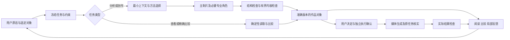

# 独立工作台产品总监审查 · 2026-10-09

线路：US。对象：apps/us-video-studio。范围：产品定位、系统架构、Agent 编排、Skill、交互、UI、输出组织、质量与成本闭环。本文是审查与建议，不是已采用的产品决策、实施计划或费用授权。

## 1. 总体判断

当前工作台已经有较强的创作治理基础：准确版本、真实用户原话、不可变产物、独立生成授权、未知提交恢复和学习证据均有实现。它能保留复杂创作过程，但还没有稳定地把这些复杂性消化在系统内部。用户仍承担了相当多的流程接续、解释规则、定位结果和质量检查工作。

如果从 Higgsfield 的产品方向看，最需要补的是“尽快拿到可评估作品，再低成本定向迭代”；从 TapNow 的产品方向看，最需要补的是“作品对象可直接引用、修改和继续使用，聊天与画布围绕同一对象协作”。本工作台的优先投入应是任务完成效率、对象交互和内容验收，而不是增加角色数量、模型入口或装饰性画布功能。

以上是基于公开产品材料提炼的审查视角，不代表两家公司内部观点，也没有推断它们的私有架构。判断沿用本项目“真实电商实践 → 可复用工作流 → 后续平台”的阶段关系，不将当前个人工作台按企业 SaaS 的多租户标准判为不合格。

| 维度 | 当前判断 | 最重要的产品影响 |
| --- | --- | --- |
| 定位与任务闭环 | 能力范围明确，交付闭环不稳定 | “继续做完”仍可能变成多轮人工接力 |
| 状态、版本与授权 | 基础较强，存在停止与 UNKNOWN 边界缺陷 | 减少用错版本、误生成及重复提交 |
| Agent 编排 | 已有阶段工具清单和角色任务，协调开销偏高 | 小任务慢，大任务可能耗尽循环 |
| Skill 与学习 | 已有真实证据库和角色化加载，效果闭环不足 | 可追溯不等于可重复改善 |
| 产品交互 | 自然语言和准确对象绑定已有基础，直接操作不足 | 用户必须理解内部阶段与恢复状态 |
| UI | 视觉风格统一，阅读层级弱于视觉风格 | 画布占据大面积，却不能高效审作品 |
| Agent 输出组织 | 回执、日志、正文及作品都存在，层级不清 | 用户看到很多“做了什么”，较难判断“现在有什么” |
| 质量与成本 | 记录诚实，内容通过与真实金额仍有缺口 | 难以衡量每个合格作品的代价与成功率 |

## 2. 证据与本次边界

本次读取当前代码，并在正在运行的 4760 工作台实际查看首页、两个已有项目、方向阅读、分镜、历史图片、图片预览、学习库、方法库、费用和 390×844 窄屏。共保存、重新打开检查了 10 张截图。没有发送创作指令、批准方案、核实提供方任务、提交生成、变更模型连接或恢复业务任务。

- 开始时 Git 工作区无改动；当前 HEAD 为 ab7f323ca12b。
- 当前进程的后端与方法指纹为 611da12c6cd6692c；本次从磁盘重新计算得到相同指纹。
- 服务启动时记录的 source_revision 为 641020175af2、source_modified=true。这是启动快照；与当前 Git HEAD 不同不等于实际代码未加载，故使用指纹核对。
- 服务数据根匿名标识为 a418ae499da7。未读取或展示连接密钥。
- 官方公开资料于 2026-10-09 检索；用于产品机制对照，未登录两家产品实测。
- 仓库已有真实验收记录作为历史运行证据引用，明确区别于本次复测；旧截图未用作本次页面证据。
- 本次重新执行 test_steer_intent.py：30 passed；另外直接复现了两个未覆盖的复合停止句。架构审查另尝试 5 个离线模块，结果为 2 passed / 119 errors；119 项均在 pytest 临时目录 fixture 创建时受权限阻断，不能视为产品失败或覆盖通过。没有跑全量测试，也没有新增测试或修改生产代码。
- 截图保存在 Git 外的 C:/Users/Jeffery/AppData/Local/Temp/little-else-product-audit-20261009/。这是本机审查证据，未上传外部平台；临时目录将来被清理后，文中的截图链接可能失效。

## 3. 两种产品总监视角应如何落在这里

Higgsfield 的公开 Marketing Studio 以任务分类、模板和商品输入缩短创作起步；Cinema Studio 提供镜头控制、可复用人物/场景/道具，并明确区分 AI Director 准备输入与用户生成。值得借鉴的是把创作意图变成可见、可调整、可比较的控制，而不是照搬模型数量或“一键成功”的宣传。官方资料：[Marketing Studio](https://higgsfield.ai/creator-hub/help-center/tools/how-do-i-use-marketing-studio-to-create-video-ads)、[Cinema Studio](https://higgsfield.ai/creator-hub/help-center/tools/how-do-i-use-cinema-studio)。

TapNow 的公开交互把节点作为可引用的创作对象：选中素材、通过 @ 指定用途、保存 Agent 输出、将结果送回对话修订，并用 Queue 承接忙时指令。值得借鉴的是对象与任务的关系可见；画布上的一条线应有输入引用含义，移动卡片本身不构成生产编排。官方资料：[节点与连接](https://docs.tapnow.ai/en/docs/canvas/understand-nodes-and-connections)、[Agent 对话](https://docs.tapnow.ai/en/docs/agent/chat-with-agent)、[输出管理](https://docs.tapnow.ai/en/docs/agent/manage-agent-outputs)、[会话与队列](https://docs.tapnow.ai/en/docs/agent/manage-conversations)。

| 产品问题 | Higgsfield 视角会优先问 | TapNow 视角会优先问 | 本工作台应采用的落点 |
| --- | --- | --- | --- |
| 从哪里开始 | 多快能看到有价值的候选作品 | 输入对象与目标是否明确 | 保留一句话入口，补少量“只分析/给方向/改这页”等任务捷径 |
| 如何控制结果 | 哪些视觉参数能直接改变作品 | 哪个对象、版本、引用被改变 | 对象级选择、局部修改、可见影响范围 |
| 如何返工 | 能否只修坏掉的一处 | 新旧结果和来源能否对照 | 镜头/页面版本比较，保留未受影响部分 |
| 如何降低浪费 | 能否先验证高风险画面 | 是否知道当前任务引用哪些材料 | 在准确授权内先验证关键问题；不自动增加生成 |
| 如何判断完成 | 得到了什么可用结果 | 结果是否成为可继续使用的对象 | 成图/成片、检查报告、文案和导出包聚合 |
| 如何形成优势 | 单位时间的有效创意产出 | 工作流可组合与复用 | US 商品事实、表达方法和真实经营反馈形成闭环 |

本工作台最有价值的差异化机会是“有商品证据约束、能解释和改进商业表达的创作工作台”。这仍是建议方向，当前资料不能证明已有商业效果优势。

## 4. 按优先级排列的发现

P1 表示影响控制权、关键任务完成或近期使用价值；P2 表示影响效率、可维护性及规模增长。以下没有发现可据本次证据直接确认的 P0 生产事故。

### F01 · P1 · 明确停止会因附带解释而被判为可自动接续

**性质：本次可复现的确定缺陷。**

直接调用当前分类函数：

| 用户原话 | 当前分类 | 自动接续许可 |
| --- | --- | --- |
| 先停一下，我想想 | work | true |
| 先不要继续了，我晚点回来 | work | true |
| 停止当前任务 | stop | false |

steer_intent.py 的停止分支要求每个子句都符合停止或特定等待表达，后半句解释无法匹配时整条落入 work。jobs.py 对 work 设置停止标记，同时允许后继任务处理原话。后继模型可能重新理解为停止，但系统已经失去了“明确停止不自动接续”的确定保证，并可能增加文字调用；本次未实测实际新增费用，更未观察到因此自动提交媒体。

代码：[steer_intent.py:89](../studio/steer_intent.py#L89)、[steer_intent.py:125](../studio/steer_intent.py#L125)、[jobs.py:31](../studio/jobs.py#L31)、[jobs.py:606](../studio/jobs.py#L606)。

**建议：** 把立即停止、继续当前任务和附带解释分开处理；不确定是否应接续时保留停止，新的执行要求另行绑定。测试同时覆盖否定停止、先做完再停和明确修改，避免简单加入“含停字即停止”。验收应检查无 successor、无新模型调用，而不只检查聊天文案。

### F02 · P1 · 视频结果 UNKNOWN 被降为普通失败，放开重复提交保护

**性质：代码与官方状态契约确认的确定缺陷；未进行真实提供方或端到端费用复现。**

当前 Wan 3.0 查询返回 FAILED、CANCELED 或 UNKNOWN 时，poll_video 均保存为 failed，并提示“可检查输入后再发起新任务”。而 prepare_generation 对同镜头的重复提交保护不包含 failed。UNKNOWN 因而离开了未解决任务集合；后续经用户再次授权可发起新任务，原结果仍可能没有查清。这不是系统自动重生成，但会向用户给出不可靠的重做建议。

阿里云官方说明，UNKNOWN 代表任务不存在或状态未知，task_id 超过 24 小时查询有效期也会返回 UNKNOWN。因此该状态不能证明原任务未成功或未收费。[Wan 3.0 官方接口](https://help.aliyun.com/zh/model-studio/wan3-video-generation-api-reference)。

代码：[production.py:2265](../studio/production.py#L2265)、[production.py:1923](../studio/production.py#L1923)、[wan_video.py:25](../studio/agents/wan_video.py#L25)。

**建议：** 将 UNKNOWN 保留为结果待核实，查询过期时明确说明恢复限制，保留 task_id、endpoint 和原始回执。不要继续盲目轮询，也不要因查不到就推断零费用或普通失败。验收应覆盖 UNKNOWN 后仍阻止原镜头重复准入、页面不给出直接重做暗示、成功和真实失败不受影响。

### F03 · P1 · 简单核对仍需要通用 Agent 反复定位与读取

**性质：当前实现风险，已有真实运行记录支持；本次没有重跑付费模型。**

最近一次仓库验收中，两行英文的只读核对用了 6 次文字调用、187,192 输入 token、240 秒。此前同类成功基线为 375,262 输入 token；已有优化有效，但不能把输入减少等同于任务效率已经达标。[真实验收记录](creative-quality-validation.md#2026-10-09-只读请求阶段一致性与真实复测)。

本次当前费用页另显示，9 月 28 日项目累计文字调用 193 次、已记录 9,989,141 token；其中主制片 132 次、7,635,481 token，占该表已记录 token 的约 76.4%。这是一个长历史项目的累计值，含返工和不同任务，不是单条视频成本，也不能证明全部主制片消耗都可以去掉。它足以提示应优先分析协调成本，而不是只优化出图价格。金额未知不能换算成确定人民币支出。

代码已存在阶段清单，问题不是“没有路由”。完整创作上下文仍组合摘要、阶段、上游正文、证据和方法；循环压缩主要作用于 messages，缺少统一的请求级预算。代码：[orchestrator.py:1462](../studio/agents/orchestrator.py#L1462)、[client.py:695](../studio/agents/client.py#L695)。

**建议：** 对查看、逐字比较、准确局部替换使用服务端已定位的最小对象包。关键原文完整保留，其余按需展开；逐字比较可由确定性代码完成，解释或判断才调用模型。记录每次请求的系统说明、工具描述、历史、对象正文各自体积。按任务评估调用数、等待时间和输入量，不只看每次请求是否安全。

### F04 · P1 · 循环上限与用户交付终点不匹配

**性质：设计风险，已有失败样本。**

默认 max_tool_rounds=12。已有真实验收记录显示，采用方向后在材料方案修正阶段消耗完主制片轮数，没有进入 writing；“采用并继续”因此没有完成用户期望的接续。当前限制有防止无限循环的价值，不应直接移除。

代码：[config.py:108](../studio/config.py#L108)、[client.py:679](../studio/agents/client.py#L679)、[client.py:919](../studio/agents/client.py#L919)、[orchestrator.py:416](../studio/agents/orchestrator.py#L416)。历史证据：[分层验收记录](creative-quality-validation.md)。

**建议：** 按交付阶段设检查点，在原任务、原授权和已保存准确产物下推进已承诺的下一步；同时保留总调用、总等待和无进展停止条件。有效阶段完成后的接续，与提供方失败后的重试应是两种不同机制。用户停止、待决定、来源失效和未知提交必须优先阻断。

### F05 · P1 · 主制片发现新稿问题时，已经进入不能修稿的阶段

**性质：当前设计造成的质量闭环缺口。**

专业角色保存后退出；主制片在只读 finishing 阶段通读完整新稿并指出最影响采用的问题，同一阶段明确禁止修改，实际请求 tools=[]。因此“看出问题”和“交付已经修好的稿件”之间仍需要额外一轮用户接力。角色自身已有自检要求，不能据此说完全没有自检；缺的是明确、可观察、可定向修正的交付前检查步骤。

代码：[dispatch.py:643](../studio/tools/dispatch.py#L643)、[orchestrator.py:927](../studio/agents/orchestrator.py#L927)、[client.py:603](../studio/agents/client.py#L603)。

**建议：** 在正式收尾前做一次有界内容检查。发现明确且属于原范围的问题时，交给原角色定向修订；涉及新创作方向、事实或费用则提出具体选择。检查绑定准确版本、段落及可观察证据。无需恢复被停用的独立 reviewer，也不增加用户逐项审批。

### F06 · P1 · 生成完成后，工作台尚未承担第一轮结果检查

**性质：能力缺口，当前状态措辞本身诚实。**

图片保存后进入“等待你的图审”，视频保存后进入“待观看验收”。文件校验可以证明媒体可读，不能证明商品结构、图中文字、动作、连续性或声画成立。现有文字输入自检也明确没有看到结果像素。

代码：[production.py:1885](../studio/production.py#L1885)、[production.py:2261](../studio/production.py#L2261)、[production.py:2318](../studio/production.py#L2318)。

**建议：** 将实际输出与输入承诺对照，先呈现发现的问题、位置和无法判断项，再交 Jeffery 图审。图片看商品结构、文字和跨页连续性；视频还需真实声画、时间覆盖和动作检查。检查如果需要新增付费观察，应事先纳入准确执行确认，不能借“自检”自动增加费用、批准图片或重生成。

### F07 · P1 · 画布以文档和阶段为中心，作品审阅效率偏低

**性质：本次页面观察；不是所有项目必然出现相同缩放。**

10 月 7 日项目首次打开时画布为 47%，卡片集中在下部，上半大面积空白，正文难以辨读。旧项目切到“看图片”后，一屏只能看到部分图片；每张又占用较大面积重复失效说明。390×844 虽没有页面横向溢出，但先显示长需求和方向，作品结果仍在后面。

当前画布按需求、人物/场景/分镜、媒体结果三个固定区域绘制连接；图卡位置保存在 localStorage，连接不承担用户配置真实引用关系的作用。作为只读总览合理，但不能把这一层当作 TapNow 式对象编排能力。

代码：[creative-board.js:250](../studio/web/creative-board.js#L250)、[creative-board.js:565](../studio/web/creative-board.js#L565)、[creative-board.js:588](../studio/web/creative-board.js#L588)、[creative-board.js:770](../studio/web/creative-board.js#L770)。页面证据：步骤 2、4、5、10。

**建议：** 默认进入当前作品的阅读视图；图片用整组缩略图加单页检查，视频用镜头条加预览，方向用并排比较。自由画布作为整理和探索视图保留。画布节点只显示短摘要、缩略图、版本、检查状态和一个下一动作；完整执行描述进详情。默认阅读不能依赖缩放长文本。

### F08 · P1 · 输出中内部协调过程占据用户的主要注意力

**性质：本次页面观察及当前渲染逻辑；历史消息中的旧故障不等于当前仍未修复。**

关闭“技术记录”后，本轮进展仍逐条显示诸如“校验挡了三次”“收窄字段”“重新声明范围”“受托角色未能交回”等内容。当前渲染器把所有 progress 项直接放进主对话，只有 note/artifact 受技术记录开关控制。保留历史真实记录是正确的，但它们不必持续占据创作者阅读主线。

代码：[app.js:1520](../studio/web/app.js#L1520)。页面证据：步骤 2、4、5 的右侧对话；本次 DOM 读取确认历史进展仍在默认层。

**建议：** 用户层只保留阶段进展、作品回执、待决定项和可执行的失败说明；内部校验归工作记录。运行中合并同类进展，结束后收成一条任务摘要。回执必须带准确作品入口，不让用户只靠模型一句“已完成”判断。

### F09 · P2 · 结果对象的身份、来源和可操作性在预览中丢失

**性质：本次特定历史图片路径的体验缺口。**

打开旧项目的第一镜图片，预览标题变成长文件名和 2.0 MB，画面旁没有镜头、脚本版本、失效原因或查看原输入入口。当前有效生成图已有“批注这张生成图”，不能泛称没有反馈；本次历史图因输入不满足当前条件而不能批注是合理保护，但应在预览内解释并提供只读追溯。

代码：[app.js:1176](../studio/web/app.js#L1176)、[app.js:1203](../studio/web/app.js#L1203)。页面证据：步骤 6。

**建议：** 所有预览共用对象头：人类可读名称、页/镜头、来源版本、当前/历史、检查状态。增加“查看原输入/对照当前版”；仅对合法对象提供修改。文件名放技术信息。不能为了操作方便恢复旧稿权限。

### F10 · P2 · 项目和任务状态需要更清楚地分层

**性质：本次观察的语义负担，不是已确认的状态错误。**

三个项目都叫“https带货视频”，需要靠创建时间区分。旧项目同时显示“本轮完成”和“镜头 01 的图片结果待确认”，这两者可能分别指输入准备任务和媒体结果，逻辑上不冲突，用户却需要自行理解。

**建议：** 新项目建议标题包含商品、目标与主方向，用户可编辑；不自动重写历史标题。状态明确表达“本轮完成：输入准备”“整组：尚未就绪”“图片：原提交待核实”。异常区聚合影响范围和一个首要动作，避免同一原因在每张卡上重复长段解释。

### F11 · P2 · 全工作台只有一个活跃主任务，跨项目工作会被拒绝

**性质：有意的架构取舍，限制独立工作台的使用效率。**

JobManager 在任一 active 或角色 future 存在时拒绝新提交，并明确“未排队、未调用模型”。角色层可以有异步任务，不应误称系统完全不支持并行。问题是项目 A 长时间生成时，项目 B 的工作仍受全局任务门影响。

代码：[jobs.py:395](../studio/jobs.py#L395)。

**建议：** 先分离远端媒体任务等待与创作执行槽，做可见的等待队列和安全的只读任务分流，再评估跨项目有限并发。保持每个项目的有序写入、提供方容量限制、授权和停止边界。当前单用户阶段无需引入分布式消息系统；也不要直接去掉全局锁而破坏台账和停止信号。

### F12 · P2 · 全量扫描方式有长项目增长风险，尚未证明是四分钟等待的主因

**性质：代码可确认的复杂度风险，缺少本次性能基准。**

append_event 每次读取完整事件日志取序号；写入前健康检查遍历项目元数据、日志、产物与角色会话。状态读取又多次消费这些数据。长会话会放大磁盘和解析成本。

代码：[store.py:230](../studio/store.py#L230)、[store.py:239](../studio/store.py#L239)、[project_integrity.py](../studio/project_integrity.py)。已有验收记录测过一次完整性扫描约 0.099 秒；不能据此将全部模型等待归因于存储。

**建议：** 先记录读取、投影、锁等待和提供方等待的分项耗时，再增加同一事实源上的可重建索引与增量投影，按事件游标更新。保留完整校验与篡改发现。若增长证明需要事务化存储，再迁移；不立即另建第二套任务事实源或更换整个技术栈。

### F13 · P2 · 方法版本可追溯，但项目方法还没有作为整体固定

**性质：方法治理风险。**

library-pin.json 固定案例库，Skill 正文和默认方法卡却在每次构建上下文时读取当前仓库文件。续做旧项目可能变成旧案例库加新 Skill。各次快照保存 hash 有助追溯，但“知道变了”和“主动选择何时升级”仍是两回事。

代码：[learning.py:223](../studio/learning.py#L223)、[learning.py:386](../studio/learning.py#L386)、[learning.py:540](../studio/learning.py#L540)。

**建议：** 项目绑定案例库、Skill、方法卡的版本清单和可恢复正文；允许明确升级后用于后续任务。强制安全契约始终由当前运行层执行，不因冻结旧方法而回退。案例证据、方法、运行权限三者分开。

### F14 · P2 · 方法召回与效果学习尚未成为同一条闭环

**性质：规模化设计风险与验证空白。**

案例按标签交集取前 4 条；方法目录则携带较多 procedure/checks，并受字符预算截断。当前已有资格、反例、holdout 和适用性约束，不是简单“把全部记忆塞进 prompt”。但库增长后仍可能由顺序影响实际召回；记录某方法被使用也不能证明它改善了作品。

代码：[creative_learning.py:530](../../../scripts/creative_learning.py#L530)、[learning.py:1173](../studio/learning.py#L1173)、[learning.py:1209](../studio/learning.py#L1209)、[method_selection.py:65](../studio/method_selection.py#L65)。

**建议：** 先以任务、商品、交付形式、创作难点和不适用条件排序，再加载少量完整方法。方法卡增加可核验的预期作用和失败反例；用相同任务基线比较首次可采用率、严重漏检和人工修订。无需立即引入向量库，也不能把用户接受一次稿件升级为市场有效规则。

### F15 · P2 · 可访问性已有基础，但预览焦点恢复存在实际缺口

**性质：本次行为观察及代码确认。**

页面有跳过链接、区域名称、图片移动的键盘说明；窄屏页面宽度与滚动宽度均为 390，未见页面级横向溢出。素材预览按 Escape 能关闭，但本次关闭后焦点落回 body，没有回到原图入口；openViewer/closeViewer 也未保存和恢复触发元素。没有做全站读屏、对比度和全部键盘路径测试，不能声称整体 WCAG 合规或不合规。

代码：[app.js:1203](../studio/web/app.js#L1203)、[app.js:1252](../studio/web/app.js#L1252)。

**建议：** 弹窗共用焦点管理，打开时进入、限制焦点范围、关闭回原对象。长段画面正文不要完整复制成按钮 accessible name；使用“反馈第 2 镜画面”并以描述关联正文。改善灰色小字可读性前先做实际对比度测量。

### F16 · P1 · 工程验证成熟度领先于业务能力验证

**性质：明确的验收空白，不是功能不存在。**

当前有大量状态、授权、停止和结构回归；最近记录也包含真实图片、局部修订和图文 ZIP 交付。不能沿用旧结论说“没有图文导出”或“没有真实出图”。但记录仍明确三页整组质量未通过，视频生成与其他代表任务未完整验收，真实业务验收已暂停。

证据：[creative-quality-validation.md](creative-quality-validation.md)、[product-improvements.md](product-improvements.md)。

**建议：** 后续经明确授权恢复时，沿现有十类任务验证，不再建立新台账。每次同时记录任务完成、内容合格、人工介入、时延和累计成本；发布后才补真实商业反馈。产品状态必须区分“保存成功、检查完成、用户采用、发布验证”，不把测试通过数或 ZIP 成功作为商用通过。

## 5. 架构和编排应怎样演进

建议保留 Python 模块化单体、既有 Store/Pipeline、原始事件和唯一决定写入点。当前痛点尚不能支持引入微服务、全面换前端框架或迁移到另一套 Agent runtime 的成本。

建议让确定性运行层负责对象定位、依赖、版本、权限和完成判定，模型负责理解、创作和有证据的判断。用户侧仍只面对一个主制片，内部角色按交付需要调用。

此图是建议的职责关系，不表示目前已经全部实现。媒体结果检查若新增调用，需纳入用户准确费用授权；不能把图中的箭头当成自动重试或执行许可。

具体划分：

- **运行层**：承接真实输入、维护准确引用、判断允许动作、排队、停止、恢复及完成，不把每次状态定位都交给模型猜工具。
- **上下文组装**：按任务给必要原文和简短索引，完整历史按需读取；把私有推理、诊断记录与创作资料分开。
- **创作角色**：导演处理方向差异，视觉策划处理可执行设计，编剧处理表达；只改一行不必让所有角色重新开会。
- **Skill**：存方法、适用条件和判断标准；字段合法性、授权、版本和费用由代码承担。
- **结果检查**：检查准确新作品，而不是只验证字段齐全；严重问题返回原角色或等待具体决定。
- **UI**：读取同一制作投影，呈现用户可以理解的对象和动作，不在前端再造阶段状态机。

## 6. Agent 输出与产品交互的具体编排

用户应该看到四种清楚分工的东西：

| 输出层 | 主要内容 | 默认呈现 |
| --- | --- | --- |
| 对话答复 | 结果、关键取舍、需要用户决定的事 | 2–3 句开头，按需展开依据 |
| 作品对象 | 方向、脚本、页面、镜头、图片、视频 | 可直接阅读、对照、定位反馈 |
| 任务回执 | 当前阶段、准确交付、停止/失败/等待状态 | 紧邻作品，可重新打开 |
| 工作记录 | 工具调用、角色派工、校验失败、哈希和诊断 | 默认折叠，排障时查看 |

建议输出方式：

- **只分析素材**：逐图观察卡，区分可见内容、推断、图中文字和未知，给覆盖数量；不创建无关创作阶段。
- **给方向**：2–3 个有实质差异的方案，比较开场、购买理由、证据、执行难点和差异。无需每次强制三个。
- **交脚本**：先给可读的全片顺序和总时长，镜头细节按需展开；制作约束不淹没台词。
- **局部修改**：直接显示修改前后、影响镜头和未受影响范围，绑定准确对象；不重述全项目。
- **制作准备**：整组镜头/页面、实际参考、数量、已知估算与未知部分，一次准确核对。创作采用和生成授权继续分开。
- **生成结果**：整组阅读、结果检查摘要、局部反馈和当前版本下载。对旧图只读追溯，不借方便恢复旧权限。
- **失败**：什么没完成、已保存什么、下一动作是什么。接口诊断折叠；结果未知只查原任务。
- **进度查询**：优先用真实任务投影即时回答，不中断在途工作，不运行完整创作循环。

前台建议以作品为主：顶部固定项目/目标/当前状态；中央是按类型适配的阅读器；侧边是可收起的主制片；底部或次级视图是镜头/页面序列。作品详情中提供“本次使用的素材与方法”，比要求用户到方法库阅读长文更接近实际控制。

素材、人物、场景、脚本和结果之间已有准确身份基础，可逐步做成可见引用标签。选中一张图时明确“只改这张”“沿用构图”“参考场景”等操作范围，模型不必再次用自然语言猜文件名。参考身份和商品事实仍必须分开。

## 7. 推荐投入顺序与验收标准

以下是建议顺序，不是已经批准的排期；不提供没有工作量估算依据的工期承诺。

| 顺序 | 工作包 | 预期价值 | 可以证明完成的证据 |
| --- | --- | --- | --- |
| 1 | 修停止和 UNKNOWN 边界；给只读/精确局部任务减负 | 恢复控制权，减少最明显等待和调用浪费 | 复合停止后无自动接续；UNKNOWN 继续阻止重复提交；相同准确对象比较正确，调用数/时延/输入量下降 |
| 2 | 阶段检查点与交付前有界自检 | 减少“继续、继续”与把缺陷交回用户 | 原范围的采用接续到约定交付；发现明确缺陷能修正，授权边界保持 |
| 3 | 默认作品阅读器与输出分层 | 提升每天最常用的审阅、选择、修改效率 | 打开项目即可定位当前作品和首要动作；无需缩放文字；普通对话不堆内部日志 |
| 4 | 结果检查、版本对照、局部反馈 | 降低人工找错和整组重做 | 检查绑定实际像素/声画及版本；局部修改保留其他页/镜；旧图身份清楚 |
| 5 | 方法版本清单、召回与同题评估 | 让经验沉淀可验证 | 能复现某版方法输入；新方法在保留集改善指定质量指标 |
| 6 | 可见任务队列与增量投影 | 支撑更长项目和多项目工作 | 长项目读取有基准；跨项目等待可见；停止与台账无串扰 |

衡量主线建议采用“每个用户可采用作品的总成本与总耗时”，同时记录首次可采用率、严重事实错误、人工修改次数、停止后新增调用、未知任务重复提交数。没有真实金额时用调用数和已记录 token 作诊断指标，明确覆盖不全，不伪造货币成本。

当前先不以增加更多 Agent、无限画布连线、更多模型、自动发布、Virality 分数或微服务拆分作为下一阶段主目标。它们需要独立收益证据；现有完成效率与质量问题更接近当前业务瓶颈。

## 8. 本次实际页面路径与截图

以下都是本次审查捕获并从保存文件重新检查的页面。仅查看已存在内容和展示状态；每一步的“健康度”指观察到的界面，不表示相关真实生成流程已验收。

1. **首页：部分健康。** 一句话入口、商品/参考上传用途清楚；1280×720 首屏被起步区占满，继续项目在下方。已有项目标题重名，查找成本高。

2. **当前项目：需改进。** 47% 画布使文字难读，大面积空白；右侧能看到真实失败及准备继续入口，但用户仍须理解执行过程。

3. **方向阅读：部分健康。** A/B/C 并排、推荐与限制可读；摘要、结构内容和原文存在重复，比较负担仍偏大。本次没有重新采用方向。

4. **旧项目分镜：部分健康。** 脚本和缺失共同设计可见，旧稿没有被冒充可执行；长文表格、内嵌滚动与旁边状态争夺注意力。

5. **图片结果：需改进。** 已有图片保留可看，待核实原任务有入口；一屏比较数量有限，每图重复长段状态说明。本次没有点击核实或补设计。

6. **单张预览：需改进。** 图像尺寸可审阅；身份退化为文件名，历史图缺少就地追溯解释；Escape 可关闭但焦点未回原图入口。

7. **灵感库：较健康。** 真实参考缩略图建立视觉入口，观察与市场验证分开；卡片需要滚动后才能同时看到说明，仍可改善一屏比较效率。

8. **方法库：较健康，效果待证。** 三类方法名称有业务含义，版本与本轮参考可追溯；仍主要是阅读入口，方法是否改善作品需要运行证据。

9. **费用：记录诚实，决策支持不足。** 未知金额、部分用量和媒体单位明确分开；累计角色消耗可查，但缺少一次用户任务到合格结果的成本聚合。

10. **窄屏：布局基本成立，阅读顺序需改进。** 390×844 下页面 clientWidth/scrollWidth 均为 390，视图切换存在；长需求先于作品，局部滚动多。测试后已恢复桌面视口；未测试全部手机交互。

## 9. 保留项与审查限制

应保留准确版本和原话绑定、创作决定与执行授权分离、统一制作投影、产物不可变、未知任务只查原任务、独立线路与运行数据隔离、学习证据和待审差异。现有图文整组阅读、ZIP、局部修改、角色化方法和请求工具清单都是已取得的进展，不能在重设计中退化。

本次没有为评估而重新启动真实生成，也没有对历史失败补造原因。所有“商用”“质量”和效率建议都需要代表任务验证；公开竞品文档只证明其公开交互设计，不证明其实际产出效果。本报告没有采用新方向、修改站内项目、改写 Skill 或执行收费实验。
